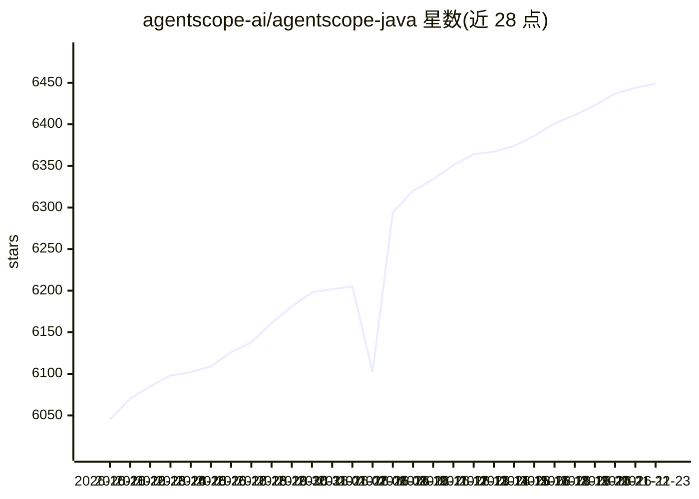

# agentscope-ai/agentscope-java

⭐ 6,449 · Java · Apache-2.0 · 推送 2026-11-22 · [GitHub](https://github.com/agentscope-ai/agentscope-java) · [官网](https://java.agentscope.io/) · 组织维护 · 中文 README

**Java agent 框架：构建分布式、可长期运行的生产级 agent**

AgentScope Java 2.0 是面向构建分布式、企业级 agent 的 Java 框架，提供 32 类类型化事件流、工具调用三级权限控制（allow/approve/deny）、AOP 式 Middleware、Docker/Kubernetes/E2B 沙箱执行环境，以及基于 Redis/MySQL/PostgreSQL/OSS/COS 的分布式会话与内存管理和跨副本恢复。通过 Maven Central 分发，要求 JDK 17+，模型提供方以独立扩展模块形式引入。

## 筛选速览

| 维度 | 判定 | 备注 |
|---|---|---|
| AI 角色 | `ai-ecosystem` | LLM/agent 周边工具 |
| 许可风险 | `permissive` | Apache-2.0 |
| 部署形态 | `None` |  |
| 模型依赖 | local-ok | 支持本地模型 |
| 硬件要求 | — | 无带数字的原话,不猜 |
| 安装摩擦 | `medium` | 含编译或系统依赖之一 |
| 成熟度 | — | 结构信号不足 |

## 能力要点

- 32 类类型化事件流与人在回路（HITL）确认机制
- 本地/Docker/Kubernetes/E2B 沙箱执行，含快照与恢复
- 分布式会话与内存管理（Redis/MySQL/PostgreSQL/OSS/COS），支持零停机滚动部署
- HarnessAgent 提供分层记忆、Markdown 技能库与子 agent 编排

## 适用场景

- 构建需长期运行、可中断恢复的多轮 agent 应用
- 企业环境下多租户隔离与敏感工具审批场景
- 子 agent 分布式部署与滚动重启时会话恢复

## 场景标签

`Agent 框架` · 领域:Agent 开发

## 证据(README 行号)

> L48: AgentScope Java 2.0 is a production-ready framework for building distributed, enterprise-grade agents, providing es
> L53: - **Workspace & Sandbox** → Run tools in isolated environments — local, Docker, Kubernetes, or AgentRun cloud sandb
> L55: - **Distributed Deployment** → True distributed session and memory management (Redis / MySQL / PostgreSQL / OSS / C

## 星数曲线

2026-10-21 6,045 → 2026-11-23 6,449（+404）

---
*卡片 v1 · prompt 1.4 · 生成 2026-11-22 · 置信度 high · 依据 README sha `41e15095cb73` · [字段定义](../../DATASET.md)*
