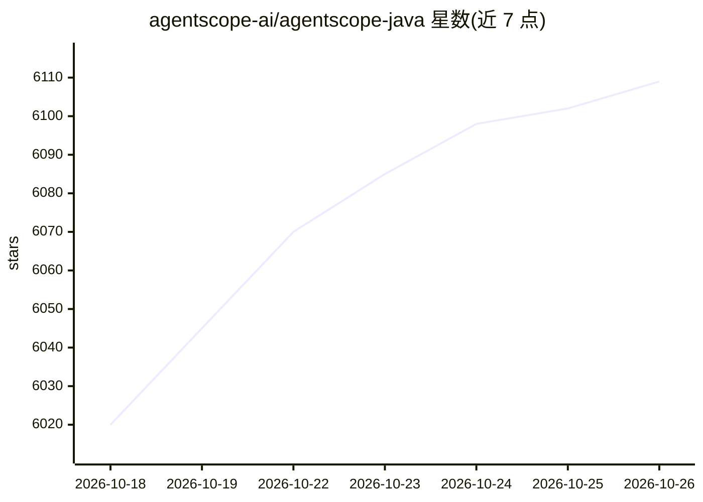

# agentscope-ai/agentscope-java

⭐ 6,109 · Java · Apache-2.0 · 推送 2026-10-25 · [GitHub](https://github.com/agentscope-ai/agentscope-java) · [官网](https://java.agentscope.io/) · 组织维护 · 中文 README

**面向 Java 开发者的分布式生产级 Agent 构建框架**

基于 JDK 17+ 的 Agent 框架，用于构建分布式、企业级、长时运行的 agent。核心机制包括：32 种类型化事件的事件流、三态权限系统（allow/approve/deny）、AOP 式 Middleware、本地/Docker/Kubernetes/云沙箱的 Workspace 隔离执行、多 agent 编排（agent_spawn/agent_send），以及基于 Redis/MySQL/PostgreSQL 等的分布式会话与恢复。模型提供方以扩展模块分发（DashScope/OpenAI/Anthropic/Gemini/Ollama），通过 Maven Central 安装。附带 AgentScope Service（Agent as a Service 平台）介绍。

## 筛选速览

| 维度 | 判定 | 备注 |
|---|---|---|
| AI 角色 | `ai-ecosystem` | LLM/agent 周边工具 |
| 许可风险 | `permissive` | Apache-2.0 |
| 部署形态 | `None` |  |
| 模型依赖 | local-ok | 支持本地模型 |
| 硬件要求 | — | 无带数字的原话,不猜 |
| 安装摩擦 | `medium` | 含编译或系统依赖之一 |
| 成熟度 | — | 结构信号不足 |

## 能力要点

- 双层 agent 架构：ReActAgent 之上叠加 HarnessAgent 工程设施
- 32 种类型化事件流与 HITL（人机协同）权限控制
- 沙箱隔离执行：本地/Docker/Kubernetes/E2B 云沙箱
- 分布式会话管理支持跨副本恢复与零停机滚动部署

## 适用场景

- 构建多租户、需水平扩展的企业 agent 服务
- 长时运行任务中引入人工审批与断点恢复
- 声明式编排多个子 agent 完成复杂工作流

## 场景标签

`Agent 框架` `多智能体` · 领域:Agent 开发

## 证据(README 行号)

> L48: AgentScope Java 2.0 is a production-ready framework for building distributed, enterprise-grade agents, providing es
> L52: - **Middleware** → AOP-style hook interception for flexibly extending the reasoning-acting loop.

## 星数曲线

2026-10-18 6,020 → 2026-10-26 6,109（+89）

---
*卡片 v1 · prompt 1.4 · 生成 2026-10-20 · 置信度 high · 依据 README sha `0be32cd984b8` · [字段定义](../../DATASET.md)*
