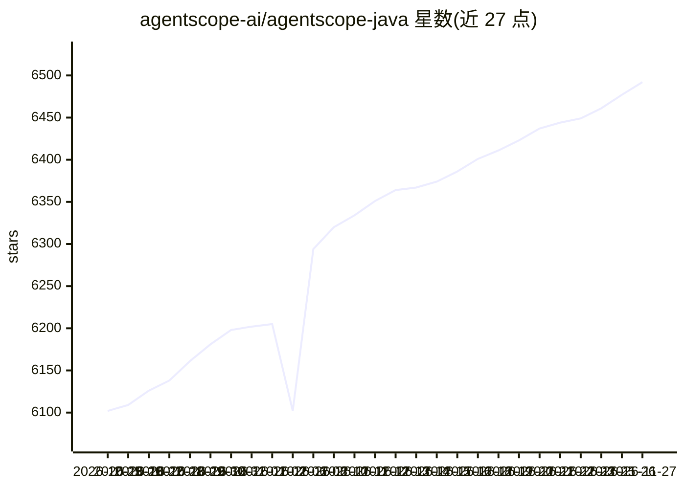

# agentscope-ai/agentscope-java

⭐ 6,492 · Java · Apache-2.0 · 推送 2026-11-26 · [GitHub](https://github.com/agentscope-ai/agentscope-java) · [官网](https://java.agentscope.io/) · 组织维护 · 中文 README

**Java 分布式生产级 Agent 构建框架**

AgentScope Java 2.0 是一个以 Maven 中央仓库发布的 Java 框架，用于构建分布式、可长期运行的 Agent。核心机制包括：32 类类型化事件流、工具调用三级权限门控（allow/approve/deny）、AOP 式 Middleware、本地/Docker/Kubernetes/E2B 沙箱工作区、子 Agent 编排（agent_spawn/agent_send），以及基于 Redis/MySQL/PostgreSQL 等的分布式会话与内存管理和跨副本会话恢复。要求 JDK 17+，模型提供方以独立扩展模块引入。许可为 Apache-2.0。

## 筛选速览

| 维度 | 判定 | 备注 |
|---|---|---|
| AI 角色 | `ai-ecosystem` | LLM/agent 周边工具 |
| 许可风险 | `permissive` | Apache-2.0 |
| 部署形态 | `None` |  |
| 模型依赖 | local-ok | 支持本地模型 |
| 硬件要求 | — | 无带数字的原话,不猜 |
| 安装摩擦 | `medium` | 含编译或系统依赖之一 |
| 成熟度 | — | 结构信号不足 |

## 能力要点

- 32 类类型化事件流支持实时前端渲染与 HITL
- 工具调用权限门控：allow / require approval / deny
- 分布式会话与状态存储（Redis/MySQL/PostgreSQL/OSS/COS）与跨副本恢复
- 沙箱隔离执行：本地/Docker/Kubernetes/E2B 云沙箱

## 适用场景

- 在 Java 企业技术栈中构建长期运行的 Agent 应用
- 需要多租户隔离与滚动重启下会话恢复的分布式 Agent 部署
- 对敏感工具调用要求人工审批的受控执行场景

## 场景标签

`Agent 框架` · 领域:Agent 开发

## 证据(README 行号)

> L48: AgentScope Java 2.0 is a production-ready framework for building distributed, enterprise-grade agents, providing es
> L82: > AgentScope Java requires **JDK 17** or higher.

## 星数曲线

2026-10-25 6,102 → 2026-11-27 6,492（+390）

---
*卡片 v1 · prompt 1.4 · 生成 2026-11-26 · 置信度 high · 依据 README sha `7b230e70f7b8` · [字段定义](../../DATASET.md)*
