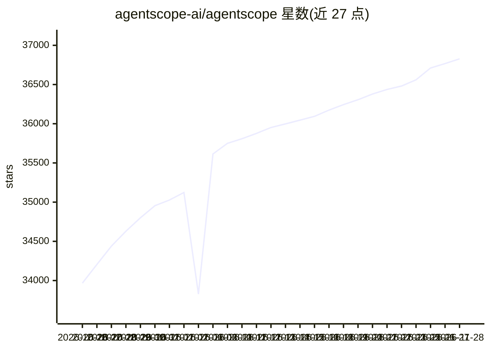

# agentscope-ai/agentscope

⭐ 36,828 · Python · Apache-2.0 · 推送 2026-11-27 · [GitHub](https://github.com/agentscope-ai/agentscope) · [官网](https://docs.agentscope.io/) · 组织维护 · 中文 README

**构建与运行多模态 LLM agent 的开发者框架及配套服务**

AgentScope 2.0 提供两层：SDK 层以 ReAct 循环、工具/MCP 管理、上下文压缩、记忆、权限与沙箱等积木组成 agent；服务层基于 FastAPI 提供多租户多会话后端与预构建 Web UI，含团队编排、IM 通道接入、RAG 服务、MCP/技能中心、持久化与调度。要求 Python 3.11+，可从 PyPI 或源码安装。以 Apache-2.0 许可发布，附两篇论文引用。

## 筛选速览

| 维度 | 判定 | 备注 |
|---|---|---|
| AI 角色 | `ai-ecosystem` | LLM/agent 周边工具 |
| 许可风险 | `permissive` | Apache-2.0 |
| 部署形态 | `library` | 以包/库形式分发 |
| 模型依赖 | local-ok | 支持本地模型 |
| 硬件要求 | — | 无带数字的原话,不猜 |
| 安装摩擦 | `low` | 无编译、无系统依赖或容器化 |
| 成熟度 | — | 结构信号不足 |

## 动量与使用信号

- 维护:`active` — 距上次 push 2.9 天,年发版 31,169 位贡献者
- 涨星:近 1 天 **+64**(自 20261016 起算)
- 安装:pypi 包 `agentscope` 月下载 196,536
- 平台:— · 协议:MCP / OLLAMA

## 能力要点

- ReAct 循环、Toolkit（Python 工具/MCP/技能）与中间件体系
- 接入 OpenAI、Anthropic、Gemini、DashScope、DeepSeek、Ollama 等多家模型后端
- FastAPI agent service：多租户、Web UI、Feishu/Discord 通道、RAG 服务
- 实时语音 agent（WebRTC）与语音克隆

## 适用场景

- 用 Python SDK 组装带工具调用与记忆的 agent
- 把 agent 部署为多租户多会话 Web 应用
- 通过 IM 通道把 agent 接入飞书或 Discord
- 搭建多 agent 团队协作与任务规划流程

## 场景标签

`多智能体` `语音 Agent` `Agent 框架` · 领域:Agent 开发

## 证据(README 行号)

> L56: AgentScope 2.0 is a production-ready, easy-to-use agent framework with essential abstractions that keep up with ris
> L110: |**Model**|LLM, embedding, and TTS across major providers (OpenAI, Anthropic, Gemini, DashScope, DeepSeek, Moonsho
> L129: AgentScope ships a batteries-included **agent service** — a FastAPI backend with a pre-built Web UI (`examples/web

## 星数曲线

2026-10-26 33,967 → 2026-11-28 36,828（+2,861）

---
*卡片 v1 · prompt 1.4 · 生成 2026-11-22 · 置信度 mid · 依据 README sha `e8552f8e6586` · [字段定义](../../DATASET.md)*
