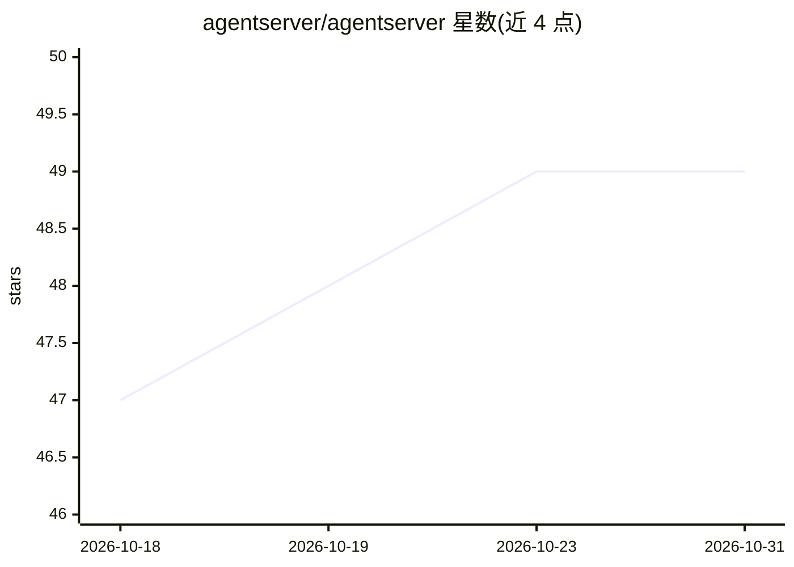

# agentserver/agentserver

⭐ 49 · Go · Apache-2.0 · 推送 2026-10-14 · [GitHub](https://github.com/agentserver/agentserver) · [官网](https://agentserver.dev) · 组织维护 · 中文 README

**个人计算网络控制平面：把分散设备接入统一工作区供 agent 调度**

自托管/托管两用的控制平面服务：将笔记本电脑、桌面机、云沙箱与手机注册为 Connector，用户通过浏览器、codex CLI、Jupyter 或微信/Telegram/Matrix 聊天窗口从一处驱动各设备上的 agent 会话。核心机制包括服务端凭证与 LLM 代理（Connector 不接触真实 provider key、按工作区限流）、Kubernetes + Agent Sandbox + gVisor 沙箱隔离与闲置自动暂停、codex 会话审计日志、GitHub OAuth/OIDC 单点登录及多用户角色协作。面向需要在多机间编排多个 agent 的开发者；依赖 PostgreSQL，自托管推荐 Helm/Kubernetes，也提供预编译二进制与 Homebrew 安装。

## 筛选速览

| 维度 | 判定 | 备注 |
|---|---|---|
| AI 角色 | `ai-ecosystem` | LLM/agent 周边工具 |
| 许可风险 | `permissive` | Apache-2.0 |
| 部署形态 | `library` | 以包/库形式分发 |
| 模型依赖 | — | README 未给出锁定关系 |
| 硬件要求 | — | 无带数字的原话,不猜 |
| 安装摩擦 | `low` | 无编译、无系统依赖或容器化 |
| 成熟度 | — | 结构信号不足 |

## 能力要点

- 多设备注册为 Connector，从 CLI/Web/IM/Jupyter 跨端续接同一 agent 会话
- 微信/Telegram/Matrix 聊天渠道远程指挥设备上的 agent
- 服务端凭证注入与 LLM 代理：按工作区 RPD 配额与用量统计
- Kubernetes + gVisor 沙箱，闲置自动暂停；codex 会话审计日志

## 适用场景

- 把办公室未完成的 agent 会话在通勤路上用微信继续
- 多名协作者共享 Connectors、凭证与沙箱并按角色控制权限
- 自托管一套带 SSO 与审计日志的多机 agent 编排平台

## 场景标签

`Agent 框架` · 领域:Agent 开发

## 证据(README 行号)

> L19: agentserver turns the laptops, desktops, cloud sandboxes, and even the phones scattered across your life into **one
> L43: - **Credential & LLM proxy** — Connectors never see real provider keys; per-workspace RPD quotas and usage tracking

## 星数曲线

2026-10-18 47 → 2026-10-31 49（+2）

---
*卡片 v1 · prompt 1.4 · 生成 2026-10-24 · 置信度 mid · 依据 README sha `53d0d802ecaa` · [字段定义](../../DATASET.md)*
