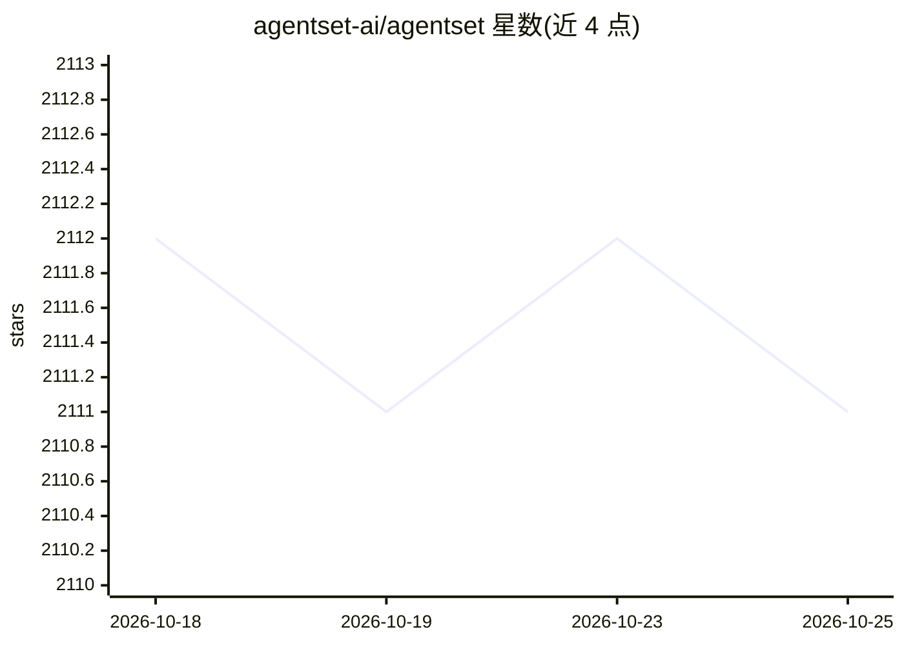

# agentset-ai/agentset

⭐ 2,111 · TypeScript · MIT · 推送 2026-10-22 · [GitHub](https://github.com/agentset-ai/agentset) · [官网](https://agentset.ai) · 组织维护

**开源 RAG 平台：构建、评测与部署生产级 RAG/Agent 应用**

面向开发者的端到端 RAG 与 agentic 应用平台：覆盖数据摄取、分块、嵌入、向量索引、检索、评测基准、带引用的聊天 playground、托管服务与开发者 API。模型无关，可自选 LLM、嵌入模型与向量数据库；提供多租户、类型化 SDK 与 OpenAPI 规范。基于 TypeScript、Next.js、AI SDK、Prisma、Supabase 与 Trigger.dev 构建；支持 Agentset Cloud 托管（含免费额度）或按文档自托管，本地开发需复制 .env 配置并以 bun 运行。

## 筛选速览

| 维度 | 判定 | 备注 |
|---|---|---|
| AI 角色 | `ai-ecosystem` | LLM/agent 周边工具 |
| 许可风险 | `permissive` | MIT |
| 部署形态 | `None` |  |
| 模型依赖 | — | README 未给出锁定关系 |
| 硬件要求 | — | 无带数字的原话,不猜 |
| 安装摩擦 | `low` | 无编译、无系统依赖或容器化 |
| 成熟度 | — | 结构信号不足 |

## 能力要点

- 端到端 RAG 工具链：摄取、分块、嵌入、检索
- 模型无关：LLM/嵌入/向量数据库均可自选
- 带引用与消息编辑的聊天 playground
- 生产托管（预览链接与自定义域名）与类型化 SDK

## 适用场景

- 搭建带引用的检索问答应用
- 构建多租户的 agentic RAG 服务
- 在统一平台内完成 RAG 应用的构建与评测

## 场景标签

`RAG` `模型评测` · 领域:评测与运维

## 证据(README 行号)

> L21: Agentset is the open-source platform to build, evaluate, and ship production-ready RAG and agentic applications. It
> L27: - Turnkey RAG: ingestion, chunking, embeddings, and retrieval
> L28: - Model agnostic: works with your choice of LLM, embeddings, and vector DB

## 星数曲线

2026-10-18 2,112 → 2026-10-25 2,111（-1）

---
*卡片 v1 · prompt 1.4 · 生成 2026-10-21 · 置信度 high · 依据 README sha `5b67935fb53d` · [字段定义](../../DATASET.md)*
