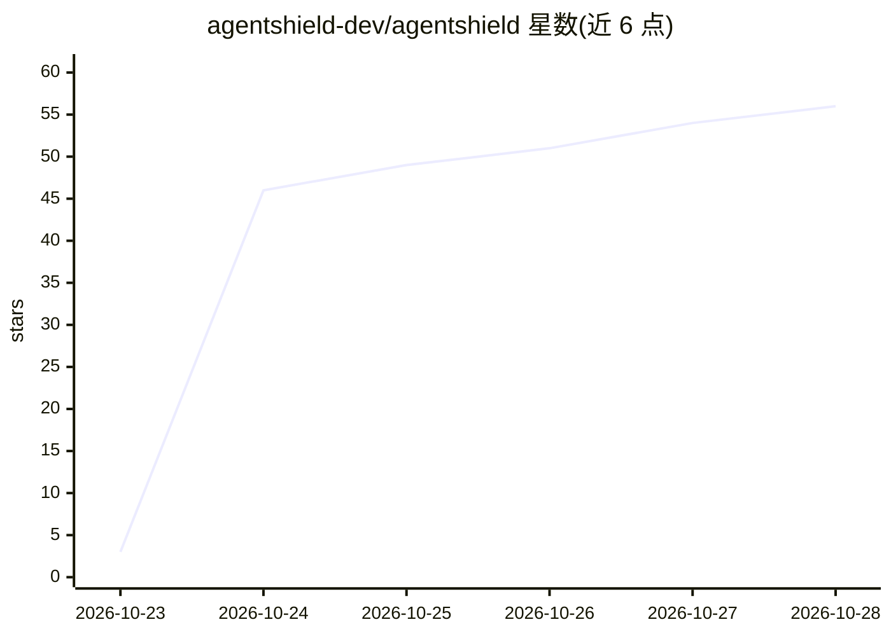

# agentshield-dev/agentshield

⭐ 56 · Go · Apache-2.0 · 推送 2026-10-24 · [GitHub](https://github.com/agentshield-dev/agentshield) · [官网](https://agent-shield.dev) · 组织维护

**给 K8s/AWS 平台安全工程师的横向移动检测与修复建议工具**

面向运行 Istio ambient、Cilium 或 agentgateway 的 Kubernetes（可选 AWS）环境的平台与安全工程师。它将工作负载、身份、网络策略与观测流量聚合成一个存储于 PostgreSQL 的图，检测器标记开启新路径或移除防护的变更；可选地由语言模型通过六个只读 MCP 图工具调查信号，仅当回答引用图内真实证据时才升级为 finding，并在人工审批后才应用修复建议。模型功能默认关闭，关闭时仍提供发现、图、遥测摄取与 UI/API，但无 findings 与修复提案。项目自述为 pre-1.0 早期阶段，API/数据库结构/标志可能破坏性变更；HTTP API 与 UI 无认证，默认绑定 127.0.0.1。

## 筛选速览

| 维度 | 判定 | 备注 |
|---|---|---|
| AI 角色 | `ai-enhanced` | 去掉 AI 部分产品仍成立 |
| 许可风险 | `permissive` | Apache-2.0 |
| 部署形态 | `self-host` | docker 或自建部署 |
| 模型依赖 | — | README 未给出锁定关系 |
| 硬件要求 | — | 无带数字的原话,不猜 |
| 安装摩擦 | `low` | 无编译、无系统依赖或容器化 |
| 成熟度 | `idea` | |

## 能力要点

- 将 K8s/Istio/Cilium/agentgateway/AWS 资源与流量遥测聚合成单一溯源图（每条事实记录来源插件/规则/观测）
- 检测器标记风险变更；模型调查仅在回答引用图内真实证据时升级为 finding
- 修复建议（NetworkPolicy/CiliumNetworkPolicy/PeerAuthentication STRICT）须经人工准备与审批后才应用
- 内置六套攻击/良性配对评测（kind 集群），make eval-run 可复现（产生真实计费模型调用）

## 适用场景

- 在 Istio ambient/Cilium/agentgateway 集群中发现有证据支撑的横向移动路径
- 在变更落地前发现开启了新暴露路径或移除防护的配置修改
- 经人工审批后应用由系统提议的网络策略修复

## 场景标签

`网络安全` · 领域:学习与行业

## 证据(README 行号)

> L53: - **Investigates with a model.** A model looks into each signal through six read-only MCP graph tools. Agentshield 
> L59: Detection itself never calls a model. It runs whenever one of the two model-calling features is enabled, and nothin
> L68: Without either feature you still get discovery, the graph and its change history, telemetry ingestion and rollups, 

## 星数曲线

2026-10-23 3 → 2026-10-28 56（+53）

---
*卡片 v1 · prompt 1.4 · 生成 2026-10-24 · 置信度 mid · 依据 README sha `4cb8222f3926` · [字段定义](../../DATASET.md)*
