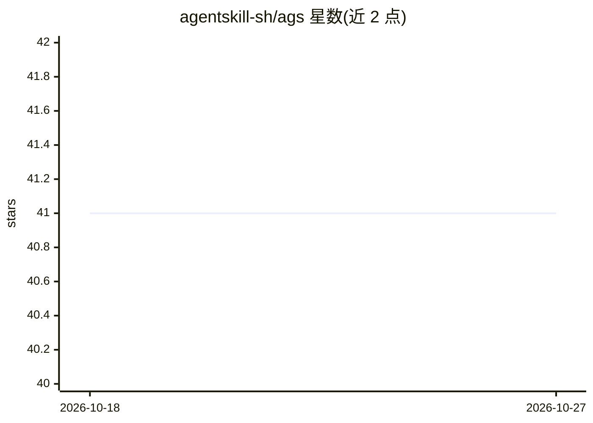

# agentskill-sh/ags

⭐ 41 · TypeScript · MIT · 推送 2026-05-11 · [GitHub](https://github.com/agentskill-sh/ags) · [官网](https://agentskill.sh) · 组织维护

**为 Claude Code/Cursor/Codex 等 15+ 平台搜索安装 agent 技能的 CLI 与 /learn 技能**

包含 ags CLI（npm 发布为 @agentskill.sh/cli）与 /learn agent 技能：可从 100,000+ 技能目录中搜索、安装、列出、更新、移除与评分技能，并按项目上下文给出推荐。CLI 自动检测平台（Claude Code、Cursor、Copilot、Codex、Windsurf、Gemini CLI 等 15+），将技能写入对应技能目录。提供两层安全扫描：服务端按 12 类威胁对每个技能静态分析并给出 0-100 安全分，低于 30 分需确认；客户端在写入文件前二次扫描。安装的技能以内容 SHA 做版本跟踪，agent 使用后自动 1-5 分评分。

## 筛选速览

| 维度 | 判定 | 备注 |
|---|---|---|
| AI 角色 | `ai-ecosystem` | LLM/agent 周边工具 |
| 许可风险 | `permissive` | MIT |
| 部署形态 | `library` | 以包/库形式分发 |
| 模型依赖 | — | README 未给出锁定关系 |
| 硬件要求 | — | 无带数字的原话,不猜 |
| 安装摩擦 | `low` | 无编译、无系统依赖或容器化 |
| 成熟度 | — | 结构信号不足 |

## 能力要点

- ags CLI 支持搜索/安装/更新/移除/评分 100,000+ 技能，命令支持 --json
- /learn 技能在对话中检索与安装技能，并按项目上下文推荐
- 两层安全扫描：服务端 12 类威胁静态分析（安全分 0-100，低于 30 需确认）+ 客户端写入前扫描
- 内容 SHA 版本跟踪与 agent 用后自动评分（1-5）

## 适用场景

- 在 Claude Code/Cursor 等 agent 中途搜索并安装所需技能
- 团队统一管理已安装 agent 技能的版本与更新
- 安装前查看技能安全分以规避恶意技能文件

## 场景标签

 · 领域:AI agent 基础设施/技能管理

## 证据(README 行号)

> L60: |**`ags` CLI**|Terminal tool to search, install, list, update, remove, and rate skills. Published to npm as `@agent
> L103: 2. **Install** writes the skill to your platform's skill directory (e.g., `.claude/skills/`)

## 星数曲线

2026-10-18 41 → 2026-10-27 41（+0）

---
*卡片 v1 · prompt 1.4 · 生成 2026-10-25 · 置信度 high · 依据 README sha `c2cfc4953419` · [字段定义](../../DATASET.md)*
