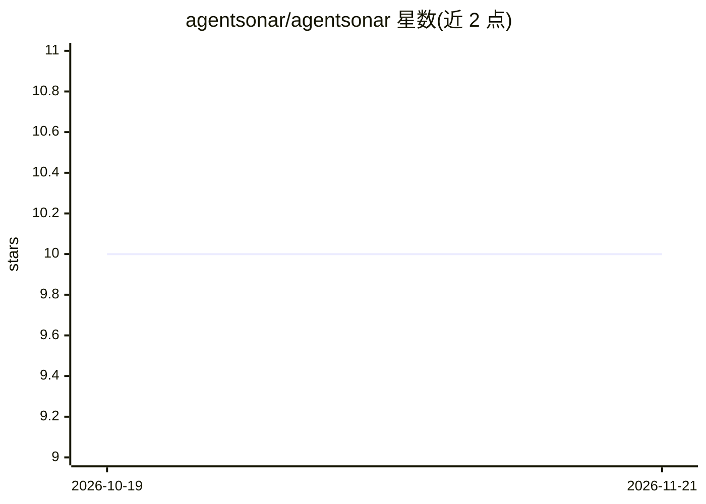

# agentsonar/agentsonar

⭐ 10 · Apache-2.0 · 推送 2026-06-07 · [GitHub](https://github.com/agentsonar/agentsonar) · [官网](https://agent-sonar.com/) · 组织维护

**监测 agent 系统协作故障的 Python/Node 工具**

面向 AI agent 系统的协调故障检测工具：监测 agent 间流量形态，捕获静默循环、重复调用、子代理爆炸、挂起工具调用、失败重试风暴与上下文窗口耗尽等故障，输出 HTML 报告，并可在达到阈值时通过 Prevent Mode 在下一次调用前自动停止运行（抛出 PreventError 或在 Claude Code 中请求批准/硬阻断）。提供 Python 与 Node 双 SDK，适配 LangGraph、CrewAI、Claude Code 及自定义编排器，无需 API key 与远程面板，含匿名遥测（可关闭）。

## 筛选速览

| 维度 | 判定 | 备注 |
|---|---|---|
| AI 角色 | `ai-ecosystem` | LLM/agent 周边工具 |
| 许可风险 | `permissive` | Apache-2.0 |
| 部署形态 | `library` | 以包/库形式分发 |
| 模型依赖 | — | README 未给出锁定关系 |
| 硬件要求 | — | 无带数字的原话,不猜 |
| 安装摩擦 | `low` | 无编译、无系统依赖或容器化 |
| 成熟度 | — | 结构信号不足 |

## 能力要点

- 检测 8 类协调故障：静默循环、重复调用、流量尖峰、冗余工作、挂起工具调用、子代理爆炸、重试风暴、上下文窗口耗尽
- Prevent Mode 可在故障越限时自动停止运行（opt-in）
- Python（pip）与 Node（npm）双 SDK，一行接入 LangGraph
- HTML 报告以图形式呈现循环、轮次计数与触发时刻

## 适用场景

- 多 agent 管线反复循环不收敛时及时发现并止损
- 监控 agent 对同一工具的重复调用以控制 token 成本
- 为自研编排器接入协调故障检测与自动停止
- 排查 MCP 服务器挂起导致的 agent 等待

## 场景标签

`LLM 可观测性` · 领域:评测与运维

## 证据(README 行号)

> L5: Catch the coordination failures that tracing tools miss — silent loops, the same work repeated over and over, runawa
> L215: AgentSonar is a *failure detector*, not a *trace viewer*. Tracing tools show you what happened. AgentSonar tells y

## 星数曲线

2026-10-19 10 → 2026-11-21 10（+0）

---
*卡片 v1 · prompt 1.4 · 生成 2026-11-20 · 置信度 high · 依据 README sha `6cfc1faa47f0` · [字段定义](../../DATASET.md)*
