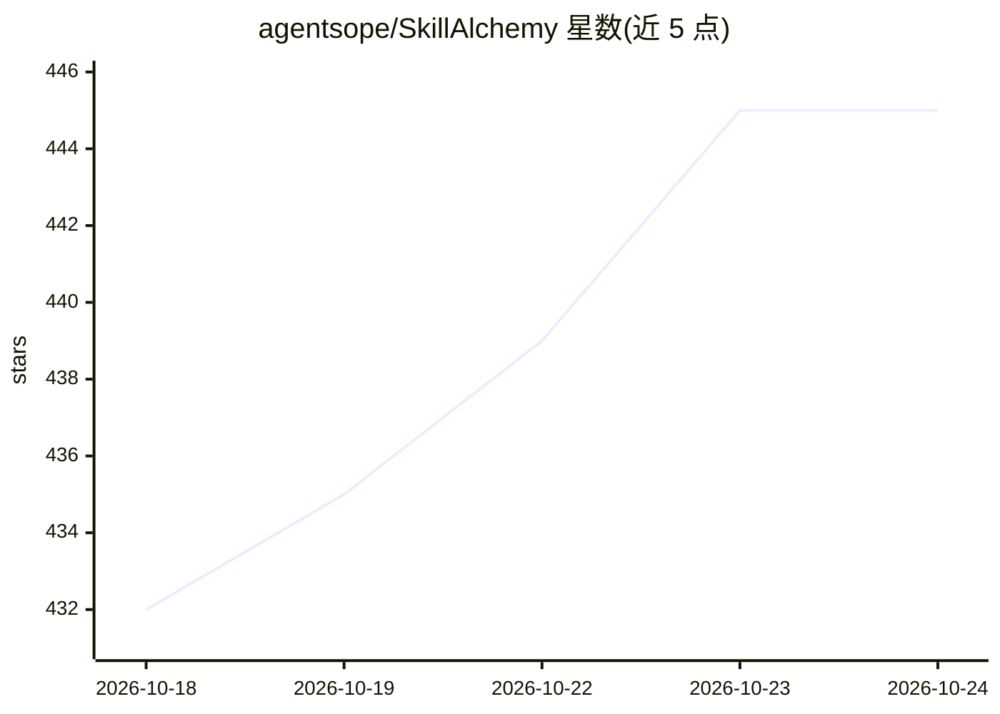

# agentsope/SkillAlchemy

⭐ 446 · Python · MIT · 推送 2026-10-24 · [GitHub](https://github.com/agentsope/SkillAlchemy) · 组织维护 · 中文 README

**将开放来源与简述编译为可安装 agent 技能的系统**

面向 agent 技能构建流程的系统：输入欠规范的技能简述，从文档、代码仓库、论文、issue 等公开来源中抽取程序性知识，划分证据支撑范围（可复用指令/限定示例/排除），并编译为 agent 可直接加载安装的技能包。提供隐含需求发现、Persona/方法论蒸馏、技能融合等功能。在 SkillsBench v1.1 的 87 个任务上评测，四种配置平均通过率 55.8%。通过 npx skills 命令安装，配有 arXiv 论文。

## 筛选速览

| 维度 | 判定 | 备注 |
|---|---|---|
| AI 角色 | `ai-ecosystem` | LLM/agent 周边工具 |
| 许可风险 | `permissive` | MIT |
| 部署形态 | `library` | 以包/库形式分发 |
| 模型依赖 | — | README 未给出锁定关系 |
| 硬件要求 | — | 无带数字的原话,不猜 |
| 安装摩擦 | `low` | 无编译、无系统依赖或容器化 |
| 成熟度 | — | 结构信号不足 |

## 能力要点

- 从异构公开来源获取有据可依的程序并判定适用范围
- 发现技能简述中遗漏的隐含需求
- 将人员、方法论、文档蒸馏为可执行技能包
- 支持融合既有工作流生成新技能

## 适用场景

- 把领域文档和方法论转成 agent 可加载的技能
- 为不熟悉的任务自动生成带证据支撑的技能包
- 将多个已有工作流融合为一个新技能

## 场景标签

`Agent 框架` · 领域:Agent 开发

## 证据(README 行号)

> L11: SkillAlchemy is an **open-world agent skill creation system** that turns underspecified skill briefs and open-world
> L32: 4. **Compiles an installable Skill package** that agents can load and use directly.

## 星数曲线

2026-10-18 432 → 2026-10-24 445（+13）

---
*卡片 v1 · prompt 1.4 · 生成 2026-10-21 · 置信度 high · 依据 README sha `9401a8aa60d0` · [字段定义](../../DATASET.md)*
