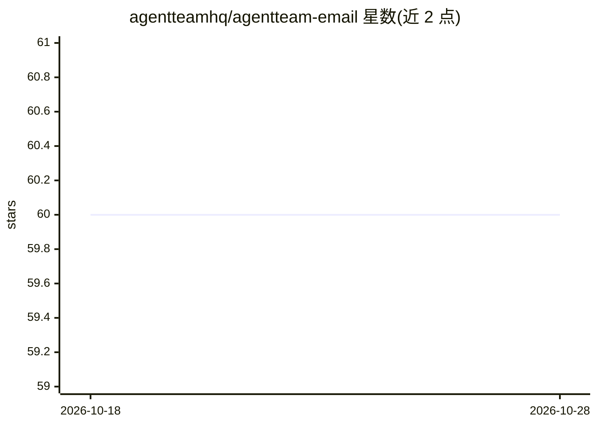

# agentteamhq/agentteam-email

⭐ 60 · TypeScript · MIT · 推送 2026-08-01 · [GitHub](https://github.com/agentteamhq/agentteam-email) · [官网](https://www.agentteam.email) · 组织维护

**为 AI agent 提供专属邮箱与收发邮件基础设施的自托管平台**

开源自托管邮件基础设施：为人和 agent 创建真实邮箱，通过受控的 mailbox 权限让 agent 读取、起草、发送邮件，而非授予整个个人账户。收件经 Cloudflare Email Routing 落入 R2 存储桶再处理；发件通过已连接域名；不信任邮件在独立界面供 agent 安全审阅。提供 Web 邮件客户端、at-email CLI 与配套 agent skill，可用 Docker Compose 或 Helm 部署。MIT 许可。

## 筛选速览

| 维度 | 判定 | 备注 |
|---|---|---|
| AI 角色 | `ai-ecosystem` | LLM/agent 周边工具 |
| 许可风险 | `permissive` | MIT |
| 部署形态 | `self-host` | docker 或自建部署 |
| 模型依赖 | — | README 未给出锁定关系 |
| 硬件要求 | — | 无带数字的原话,不猜 |
| 安装摩擦 | `low` | 无编译、无系统依赖或容器化 |
| 成熟度 | — | 结构信号不足 |

## 能力要点

- 为 agent 提供受控权限的专属邮箱（读/草稿/发送）
- 收件路径经 Cloudflare 落入 R2 存储桶，积压不影响初始接收
- 不信任邮件在专用界面供安全审阅，出站邮件支持人工审核
- at-email CLI 与打包的 agent skill 操作授权邮箱

## 适用场景

- 让 agent 分流共享收件箱并汇总分类需要关注的邮件
- agent 起草回复、人工审批后发送对外邮件
- 为长期运行的 agent 分配独立邮箱用于供应商账户与研究工作流

## 场景标签

 · 领域:邮件基础设施/AI agent 工具

## 证据(README 行号)

> L10:  Open-source email infrastructure for AI agents. Give every agent a dedicated
> L42: - A portable `at-email` CLI and agent skill for operating authorized mailboxes.
> L110: The `at-email` CLI lets agents and operators check mailbox status, review

## 星数曲线

2026-10-18 60 → 2026-10-28 60（+0）

---
*卡片 v1 · prompt 1.4 · 生成 2026-10-24 · 置信度 high · 依据 README sha `b021f50936a7` · [字段定义](../../DATASET.md)*
