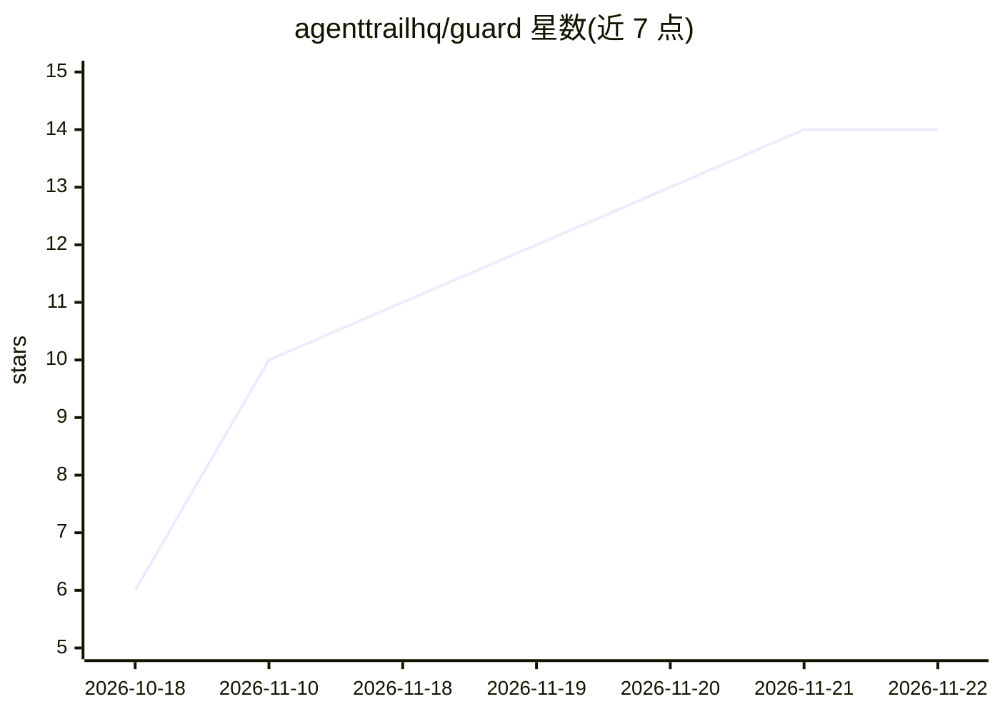

# agenttrailhq/guard

⭐ 14 · TypeScript · Apache-2.0 · 推送 2026-11-18 · [GitHub](https://github.com/agenttrailhq/guard) · [官网](https://www.agenttrail.sh) · 组织维护

**给 AI 编码 agent 加护栏的本地 CLI：工具调用执行前拦截检查**

通过连接编码 agent 的 hooks，在每次工具调用执行前对照 74 条内置护栏规则做本地匹配，可执行阻断、请求人工批准或记录警告三种动作；规则为纯数据格式，含标题、严重级与说明。覆盖 git 破坏性操作、危险删除、生产基础设施变更、密钥暴露等 11 个类别。默认离线运行、无需账号，规则可按命令形态放行、调整动作或禁用整包；内部错误时失败开放，退回 agent 原有权限流程。以 npm 全局包分发，支持 Claude Code、Cursor 与 Codex CLI 共享同一套设置。

## 筛选速览

| 维度 | 判定 | 备注 |
|---|---|---|
| AI 角色 | `ai-ecosystem` | LLM/agent 周边工具 |
| 许可风险 | `permissive` | Apache-2.0 |
| 部署形态 | `library` | 以包/库形式分发 |
| 模型依赖 | — | README 未给出锁定关系 |
| 硬件要求 | — | 无带数字的原话,不猜 |
| 安装摩擦 | `low` | 无编译、无系统依赖或容器化 |
| 成熟度 | — | 结构信号不足 |

## 能力要点

- 74 条可读规则、11 个类别包，13 条默认阻断、50 条请求批准、11 条警告
- 本地规则匹配引擎，默认无网络调用、无需账号
- block/ask/warn 三种动作按各 agent hooks 能力落地
- scan 可将历史 agent 会话转为自包含 HTML 报告

## 适用场景

- 防止编码 agent 误执行 git reset --hard 或 rm -rf 等不可逆操作
- 对 terraform apply 等生产基础设施变更要求人工批准
- 阻止 agent 读取 .env 等凭据文件并记录告警

## 场景标签

 · 领域:AI agent 安全/可靠性工具

## 证据(README 行号)

> L22: AgentTrail Guard is a free, open-source CLI
> L23: that connects to your coding agent's hooks and checks every tool call that reaches them
> L106: back. Guard puts a rule-based check on every tool call that reaches its hooks, in every

## 星数曲线

2026-10-18 6 → 2026-11-22 14（+8）

---
*卡片 v1 · prompt 1.4 · 生成 2026-11-19 · 置信度 high · 依据 README sha `11c9e95aa8b7` · [字段定义](../../DATASET.md)*
