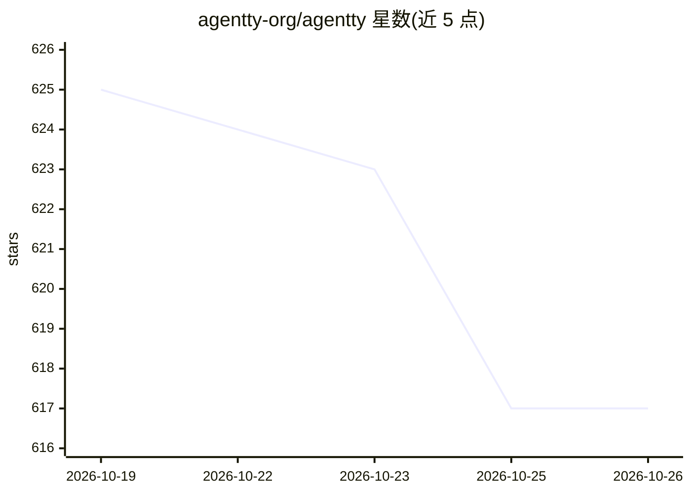

# agentty-org/agentty

⭐ 617 · C++ · MIT · 推送 2026-10-24 · [GitHub](https://github.com/agentty-org/agentty) · [官网](https://agentty.org) · 组织维护

**终端 AI 结对编程工具：单一静态二进制，任意模型接入**

用 C++26 编写的终端编码 agent，分发为约 16.7 MB 的单一静态二进制，冷启动毫秒级，无需 Node/Python 运行时。支持接入 Anthropic、OpenAI、Groq、OpenRouter、DeepSeek、Gemini 及本地 Ollama 等模型，可实时切换。内置全本地检索引擎（BM25+稠密嵌入混合、重排、GraphRAG 文档图），按需检索相关代码片段而非整仓注入。Shell/构建命令默认在 OS 级沙箱运行，支持 SSH 隔离与 CI 脚本模式。MIT 开源。

## 筛选速览

| 维度 | 判定 | 备注 |
|---|---|---|
| AI 角色 | `ai-ecosystem` | LLM/agent 周边工具 |
| 许可风险 | `permissive` | MIT |
| 部署形态 | `desktop` | 安装包/桌面程序 |
| 模型依赖 | local-ok | 支持本地模型 |
| 硬件要求 | — | 无带数字的原话,不猜 |
| 安装摩擦 | `medium` | 含编译或系统依赖之一 |
| 成熟度 | — | 结构信号不足 |

## 能力要点

- 单一静态二进制（16.7 MB），零运行时依赖，冷启动毫秒级
- 内置全本地混合检索引擎（BM25+嵌入、RRF、重排、GraphRAG）
- 多供应商接入含本地 Ollama，`^P` 实时切换
- Shell/构建命令默认沙箱执行，支持隔空（air-gapped）SSH 模式
- Smart Mode 编排者-工人多模型分层（旗舰规划+廉价执行）

## 适用场景

- 在终端里让 AI agent 读取、编辑代码并运行命令完成编码任务
- 大型代码库中按需检索相关片段以控制上下文成本
- 在无外网机器上通过 SSH 中继使用编码 agent
- 以 `agentty run` 单命令集成到 CI 流水线

## 场景标签

`编码 Agent` · 领域:编码与开发

## 证据(README 行号)

> L3:  A blazing-fast, open-source coding agent in your terminal.
> L21: - **It's not locked to one vendor.** Sign in with your Claude Pro/Max, or point it at OpenAI, Groq, OpenRouter, Cer
> L43: Claude, GPT, Groq, OpenRouter, Ollama, or any OpenAI-compatible endpoint. Switch live with `^P`.

## 星数曲线

2026-10-19 625 → 2026-10-26 617（-8）

---
*卡片 v1 · prompt 1.4 · 生成 2026-10-21 · 置信度 mid · 依据 README sha `e2f102ea6647` · [字段定义](../../DATASET.md)*
