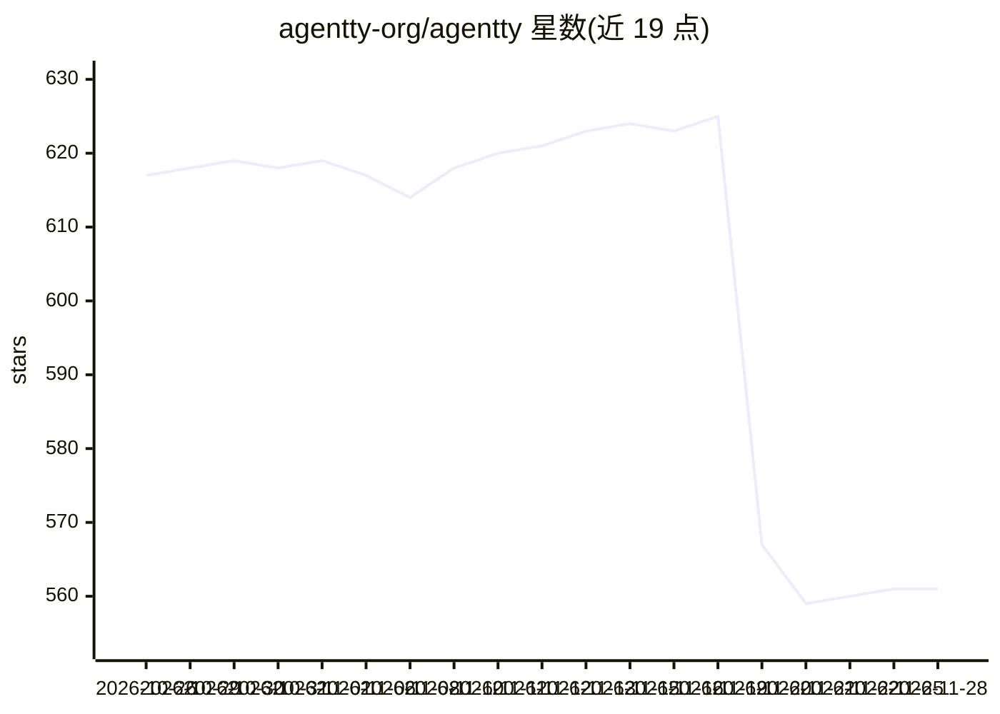

# agentty-org/agentty

⭐ 561 · C++ · MIT · 推送 2026-11-27 · [GitHub](https://github.com/agentty-org/agentty) · [官网](https://agentty.org) · 组织维护

**终端里的 AI 结对编程工具：单一静态二进制，可接入任意模型**

用 C++ 编写、以单个静态二进制发布的终端 AI 编程 agent 工具。模型决定行为，agentty 作为 harness 提供工具调用、沙箱执行、上下文管理、模型路由与终端界面。支持用已有订阅登录（Claude Pro/Max、ChatGPT、GitHub Copilot、Kimi）、十余家 API key 接入、OpenAI 兼容端点或本地 Ollama 模型。默认启用操作系统级沙箱并遮蔽凭据文件，内置本地检索引擎管理上下文，支持脚本/CI 运行、ACP 集成与 MCP 双向接入。

## 筛选速览

| 维度 | 判定 | 备注 |
|---|---|---|
| AI 角色 | `ai-native` | 本体是模型或模型工具 |
| 许可风险 | `permissive` | MIT |
| 部署形态 | `desktop` | 安装包/桌面程序 |
| 模型依赖 | local-ok | 支持本地模型 |
| 硬件要求 | — | 无带数字的原话,不猜 |
| 安装摩擦 | `medium` | 含编译或系统依赖之一 |
| 成熟度 | — | 结构信号不足 |

## 能力要点

- 单一静态二进制，无 Node/Python/Electron 依赖
- 默认沙箱：seccomp/Landlock/cgroups 等系统级隔离，凭据文件遮蔽
- 多模型接入：订阅登录、API key、OpenAI 兼容端点、本地 Ollama
- 完整工具套件与本地检索引擎，支持 Agent Skills 与跨会话记忆

## 适用场景

- 在终端中让 AI 修复失败测试、编辑补丁并重跑验证
- 通过脚本与 CI 以命令行方式运行一次性 prompt
- 在无外网的隔离机器上通过 SSH 中继使用 agent

## 场景标签

`编码 Agent` · 领域:编码与开发

## 证据(README 行号)

> L31: you steer it from. agentty is that harness, written in C++26 and shipped as a single static binary.
> L35: - **Any model.** Sign in with the Claude Pro/Max, ChatGPT, GitHub Copilot or Kimi plan you already
> L139: |`anthropic`|Claude (the default): API key or Pro/Max sign-in|`agentty login`|

## 星数曲线

2026-10-26 617 → 2026-11-28 561（-56）

---
*卡片 v1 · prompt 1.4 · 生成 2026-11-28 · 置信度 mid · 依据 README sha `3389f5a87c8e` · [字段定义](../../DATASET.md)*
