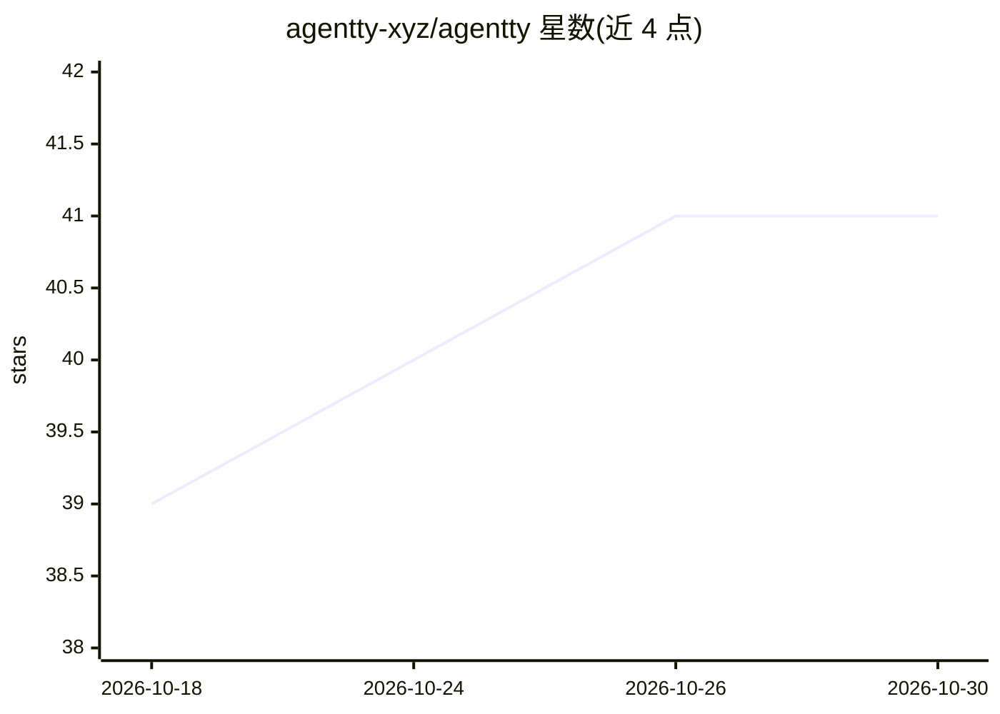

# agentty-xyz/agentty

⭐ 41 · Rust · Apache-2.0 · 推送 2026-10-29 · [GitHub](https://github.com/agentty-xyz/agentty) · [官网](https://agentty.xyz) · 组织维护

**终端中的 Agentic 开发环境：统一驱动多款 CLI 编码 agent**

以 Rust 与 Ratatui 构建的终端 TUI 应用，为 AI 辅助软件开发提供统一工作流：在一个界面中运行并监控 Codex、Claude、Antigravity、Gemini 会话，展示工具调用状态、命令预览与失败输出；通过各 provider 官方非交互 CLI 或 app-server 接口（如 claude -p、codex app-server）调用，自身不实现 OAuth 流程。含 /plan 计划-实施双 agent 工作流、实验性 Harness 会话（可接 Muse/Kimi/Qwen）与 OTLP 会话追踪。处于 0.y.z 活跃开发阶段，默认开启 PostHog 遥测。

## 筛选速览

| 维度 | 判定 | 备注 |
|---|---|---|
| AI 角色 | `ai-ecosystem` | LLM/agent 周边工具 |
| 许可风险 | `permissive` | Apache-2.0 |
| 部署形态 | `library` | 以包/库形式分发 |
| 模型依赖 | locked-api |  |
| 硬件要求 | — | 无带数字的原话,不猜 |
| 安装摩擦 | `low` | 无编译、无系统依赖或容器化 |
| 成熟度 | `idea` | |

## 能力要点

- 单界面运行并监控 Codex/Claude/Antigravity/Gemini 四种 CLI agent 会话
- /plan 工作流：只读 Planner 提案 + Implementer 执行的两阶段对话
- 通过 provider 官方非交互接口调用，不实现 OAuth、不读取 OAuth token
- OTLP 端点的会话追踪（步骤耗时、工具身份、退出码），凭据标记自动脱敏

## 适用场景

- 在终端统一管理多个 AI 编码 agent 的会话与工具调用状态
- 以计划-实施两阶段方式驱动 agent 完成代码任务
- 对 agent 会话步骤做可观测性追踪

## 场景标签

`编码 Agent` · 领域:编码与开发

## 证据(README 行号)

> L13: Agentty is an **ADE (Agentic Development Environment) for structured, controllable
> L83: Agentty currently supports Codex, Claude, Antigravity, and Gemini. Install and
> L140: Agentty uses each provider's official non-interactive CLI or app-server surface

## 星数曲线

2026-10-18 39 → 2026-10-30 41（+2）

---
*卡片 v1 · prompt 1.4 · 生成 2026-10-25 · 置信度 high · 依据 README sha `bf33e9bda0f6` · [字段定义](../../DATASET.md)*
