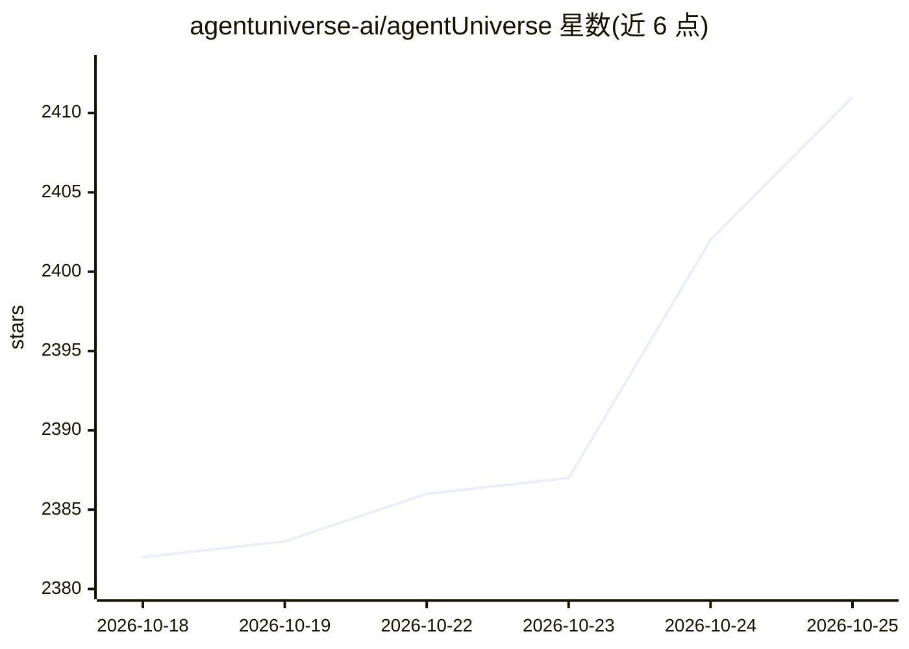

# agentuniverse-ai/agentUniverse

⭐ 2,411 · Python · Apache-2.0 · 推送 2026-10-23 · [GitHub](https://github.com/agentuniverse-ai/agentUniverse) · 组织维护 · 中文 README

**面向开发者的多智能体协作框架，源自蚂蚁集团金融实践**

agentUniverse 是基于大语言模型的多智能体框架，供开发者构建单个 agent 与多 agent 协作应用。核心机制是协作模式组件工厂：内置 PEER（Plan/Execute/Express/Review）与 DOE 两种模式，支持自定义编排新模式；提供工具、知识库、RAG、记忆模块等 agent 构建组件，以及基于 OpenTelemetry 的可观测性框架和可视化工作流画布平台（magent-ui）。通过配置文件接入 Qwen、DeepSeek、OpenAI、Claude、Gemini 等十余家厂商模型，源自蚂蚁集团金融业务实践，附 PEER 论文引用。

## 筛选速览

| 维度 | 判定 | 备注 |
|---|---|---|
| AI 角色 | `ai-ecosystem` | LLM/agent 周边工具 |
| 许可风险 | `permissive` | Apache-2.0 |
| 部署形态 | `library` | 以包/库形式分发 |
| 模型依赖 | locked-api |  |
| 硬件要求 | — | 无带数字的原话,不猜 |
| 安装摩擦 | `low` | 无编译、无系统依赖或容器化 |
| 成熟度 | — | 结构信号不足 |

## 能力要点

- PEER/DOE 多智能体协作模式组件，可自定义编排新协作模式
- 十余家模型厂商通过配置文件接入（API Key + 配置即可切换）
- 基于 OpenTelemetry 的 agent 应用可观测性框架
- MCP Server 使用与发布支持，及可视化工作流平台 magent-ui

## 适用场景

- 构建金融研报、行业分析等领域的多 agent 协作应用
- 用 PEER 模式做多步分解与迭代反馈的推理分析任务
- 在标准项目脚手架上开发、测试、部署单个智能体应用

## 场景标签

`多智能体` `Agent 框架` `RAG` `LLM 可观测性` · 领域:Agent 开发

## 证据(README 行号)

> L8: **agentUniverse is a multi-agent framework based on large language models.** It provides flexible and easily extensi
> L10: **🌈🌈🌈agentUniverse originates from the real-world financial business practices of AntGroup (https://github.com/antg

## 星数曲线

2026-10-18 2,382 → 2026-10-25 2,411（+29）

---
*卡片 v1 · prompt 1.4 · 生成 2026-10-21 · 置信度 high · 依据 README sha `4effd889ca0c` · [字段定义](../../DATASET.md)*
