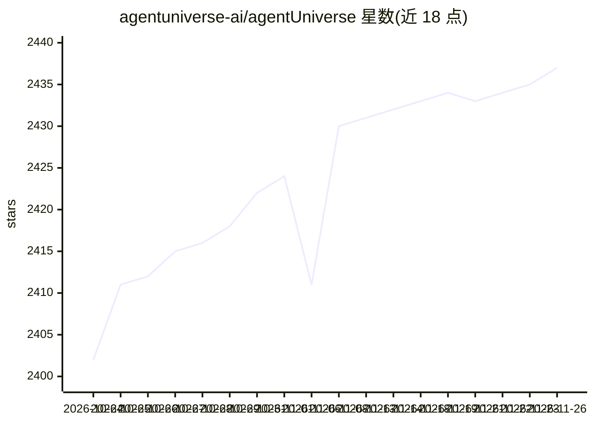

# agentuniverse-ai/agentUniverse

⭐ 2,437 · Python · Apache-2.0 · 推送 2026-10-25 · [GitHub](https://github.com/agentuniverse-ai/agentUniverse) · 组织维护 · 中文 README

**面向开发者的 LLM 多智能体应用构建框架**

基于大语言模型的多智能体框架，提供构建单个智能体的组件集与多智能体协作模式组件（PEER：Plan/Execute/Express/Review 四角色分工；DOE：数据精炼/观点注入/表达三角色），支持通过配置接入多家厂商模型，并提供知识库、RAG、MCP 服务器使用与发布、基于 OpenTelemetry 的可观测性、可视化工作流画布（magent-ui）等能力。源自蚂蚁集团金融业务实践，以 Python 包形式通过 pip 安装。

## 筛选速览

| 维度 | 判定 | 备注 |
|---|---|---|
| AI 角色 | `ai-ecosystem` | LLM/agent 周边工具 |
| 许可风险 | `permissive` | Apache-2.0 |
| 部署形态 | `library` | 以包/库形式分发 |
| 模型依赖 | — | README 未给出锁定关系 |
| 硬件要求 | — | 无带数字的原话,不猜 |
| 安装摩擦 | `low` | 无编译、无系统依赖或容器化 |
| 成熟度 | — | 结构信号不足 |

## 能力要点

- 内置 PEER 与 DOE 多智能体协作模式组件，可自定义编排新模式
- 通过配置文件接入 Qwen、DeepSeek、OpenAI、Claude、Gemini 等多家模型
- 基于 OpenTelemetry 的智能体应用可观测性框架
- 提供可视化 agentic workflow 画布平台与标准项目脚手架

## 适用场景

- 将复杂问题拆解为多步骤的多智能体协作任务（如事件解读、行业分析）
- 为金融等特定领域构建注入领域专家知识的智能体应用
- 搭建并监控多智能体应用的全生命周期（配置、测试、部署、追踪）

## 场景标签

`Agent 框架` `多智能体` `RAG` · 领域:Agent 开发

## 证据(README 行号)

> L8: **agentUniverse is a multi-agent framework based on large language models.** It provides flexible and easily extensi
> L15: * PEER pattern component: This pattern uses agents with different responsibilities—Plan, Execute, Express, and Revi
> L20: The LLM model integration can be accomplished with simple configuration, currently agentUniverse supported models i

## 星数曲线

2026-10-24 2,402 → 2026-11-26 2,437（+35）

---
*卡片 v1 · prompt 1.4 · 生成 2026-11-23 · 置信度 high · 依据 README sha `c7546ad5275e` · [字段定义](../../DATASET.md)*
