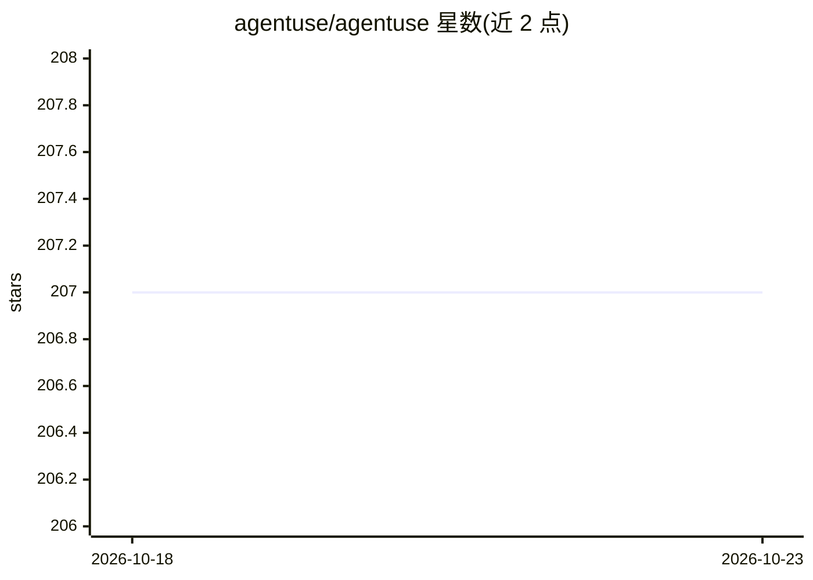

# agentuse/agentuse

⭐ 207 · TypeScript · NOASSERTION · 推送 2026-10-17 · [GitHub](https://github.com/agentuse/agentuse) · [官网](https://docs.agentuse.io) · 组织维护

**开源 AI agent 运行时：用 Markdown 定义并在后台运行可审批的自动化 agent**

面向重复性业务工作的 AI agent 运行时：agent 以 Markdown 文件（YAML 配置+自然语言指令）定义，可由 Codex、Claude Code 或引导式流程创建。提供执行循环、调度（schedule/cron/CI/CD/HTTP/Docker 触发）、持久化会话、审批门（approval: true 与 gated shell 命令）、子 agent、共享状态与 Slack 通知，并支持从运行记录生成可审查的 agent 修订。模型提供方可选 Anthropic、OpenAI、OpenRouter、Bedrock 及本地端点。形态包括 Mac 应用（DMG）、CLI+Web 仪表盘与服务器自托管（CLI 需 Node.js 22+）。

## 筛选速览

| 维度 | 判定 | 备注 |
|---|---|---|
| AI 角色 | `ai-ecosystem` | LLM/agent 周边工具 |
| 许可风险 | `none` | NOASSERTION |
| 部署形态 | `library` | 以包/库形式分发 |
| 模型依赖 | local-ok | 支持本地模型 |
| 硬件要求 | — | 无带数字的原话,不猜 |
| 安装摩擦 | `low` | 无编译、无系统依赖或容器化 |
| 成熟度 | `idea` | |

## 能力要点

- Markdown agent 文件跨本机、服务器、CI/CD 与 Docker 运行
- 审批门：会话暂停等待人工 approve/reject/comment，shell 命令可配置运行时强制门控
- 支持 MCP、SKILL.md 技能包、子 agent、共享状态与 reviewer 反馈学习
- 会话持久化：工具调用、token 用量、artifacts 与修订历史可查

## 适用场景

- 把周期性研究、报告、内容准备流程交给后台 agent 定时执行
- 对发送、发布、部署等敏感操作设置人工审批节点
- 在一台常驻服务器上托管多个项目的 agent 并通过 Web 仪表盘审查

## 场景标签

`Agent 框架` `工作流自动化` `编码 Agent` · 领域:Agent 开发

## 证据(README 行号)

> L3:  OPEN-SOURCE AI AGENT RUNTIME
> L253: ## Features for building and running AI agents
> L52:  AgentUse supplies the execution loop, scheduling, and review tools.

## 星数曲线

2026-10-18 207 → 2026-10-23 207（+0）

---
*卡片 v1 · prompt 1.4 · 生成 2026-10-22 · 置信度 high · 依据 README sha `cdf46e401d37` · [字段定义](../../DATASET.md)*
