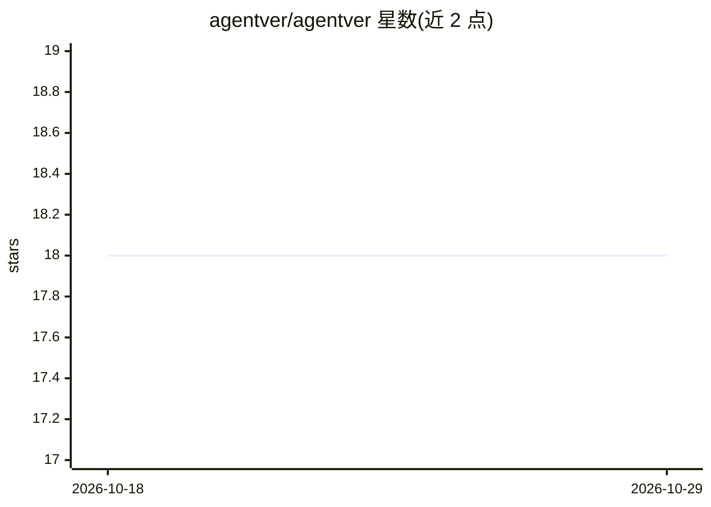

# agentver/agentver

⭐ 18 · TypeScript · AGPL-3.0 · 推送 2026-06-23 · [GitHub](https://github.com/agentver/agentver) · [官网](https://agentver.com) · 组织维护

**面向团队的 AI agent 技能管理平台：跨 43+ 助手版本化分发**

开源的 agent 技能团队管理平台：一次编写技能后分发到 Claude Code、Cursor、Windsurf、GitHub Copilot、Gemini CLI 等 43+ 编码助手，由数据层负责各 agent 的配置路径与格式转换。提供语义版本与 lockfile 的 git 原生版本管理、角色权限与审计日志、75 条规则 9 类的本地安全扫描（非 AI、规则匹配）、AES-256-GCM 凭据库、PR 式变更提案与社区技能发现。支持 npm CLI、Docker 自托管与云端托管。限制：静态扫描自述非穷尽，属纵深防御层。

## 筛选速览

| 维度 | 判定 | 备注 |
|---|---|---|
| AI 角色 | `ai-ecosystem` | LLM/agent 周边工具 |
| 许可风险 | `viral` | AGPL-3.0 |
| 部署形态 | `self-host` | docker 或自建部署 |
| 模型依赖 | — | README 未给出锁定关系 |
| 硬件要求 | — | 无带数字的原话,不猜 |
| 安装摩擦 | `low` | 无编译、无系统依赖或容器化 |
| 成熟度 | — | 结构信号不足 |

## 能力要点

- 一次编写技能，分发到 43+ 编码助手，自动检测并放置文件
- 75 条本地规则、9 类威胁的安全扫描，HIGH/CRITICAL 阻断安装
- 角色权限、审计日志与 git 原生版本控制（语义版本/lockfile/manifest）
- AES-256-GCM 加密凭据库与 PR 式技能评审流程

## 适用场景

- 团队统一管理和分发 AI 编码助手技能，保持版本一致
- 在技能安装前做安全扫描，阻断恶意技能
- 非技术成员通过 web 仪表盘创建与共享技能

## 场景标签

 · 领域:AI 开发者工具/技能分发基础设施

## 证据(README 行号)

> L19: Agentver is an open-source platform for managing agent skills across teams. Write a skill once and deploy it to eve
> L26: - **43+ agent support** — one skill, every assistant; auto-detects installed agents and places files in the right l
> L42: npm install -g @agentver/cli

## 星数曲线

2026-10-18 18 → 2026-10-29 18（+0）

---
*卡片 v1 · prompt 1.4 · 生成 2026-10-29 · 置信度 high · 依据 README sha `8dc6894ea966` · [字段定义](../../DATASET.md)*
