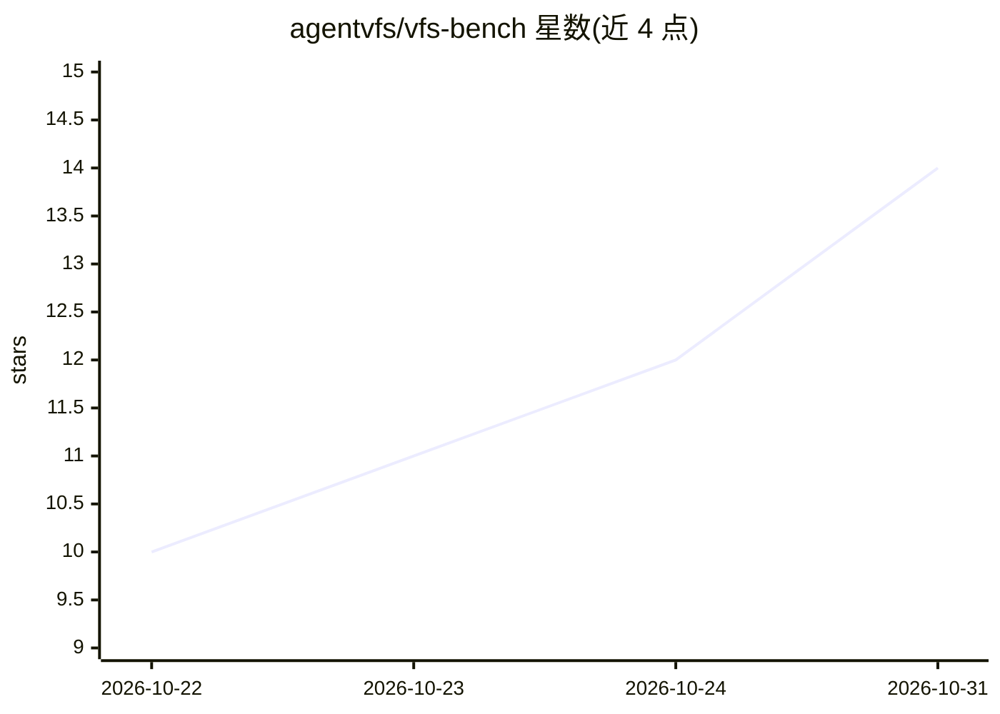

# agentvfs/vfs-bench

⭐ 14 · Python · MIT · 推送 2026-10-30 · [GitHub](https://github.com/agentvfs/vfs-bench) · [官网](https://agentvfs.org/benchmark) · 组织维护

**评测 MCP 与虚拟文件系统两种 agent 接口的对比基准**

VFS-Bench 是'一任务、双接口'的评测框架：每项任务分别通过原任务的 MCP 服务器与 AgentVFS 虚拟文件系统各跑一次，接口为唯一变量，衡量成功率（pass@1）与 token 消耗。1.0 版含 200 个任务（取自 MCP-Atlas 与 Toolathlon），覆盖 46 个外部服务，多数服务以本地伪造 API 运行并每轮重置种子，无需真实账号。面向 agent 接口与评测方向的研究者/开发者，需 Python、Node、Go、Rust 与 Docker 环境，Linux 下需 6.12+ 内核（Landlock/seccomp）。

## 筛选速览

| 维度 | 判定 | 备注 |
|---|---|---|
| AI 角色 | `ai-ecosystem` | LLM/agent 周边工具 |
| 许可风险 | `permissive` | MIT |
| 部署形态 | `None` |  |
| 模型依赖 | — | README 未给出锁定关系 |
| 硬件要求 | — | 无带数字的原话,不猜 |
| 安装摩擦 | `low` | 无编译、无系统依赖或容器化 |
| 成熟度 | — | 结构信号不足 |

## 能力要点

- 200 任务双臂对比，MCP 工具调用 vs 虚拟文件系统+虚拟 CLI
- 本地伪造服务复现 API、每轮重置种子，评测无需真实账号
- 原任务文本、种子数据与评测器不变，接口为唯一变量
- 结果：平均省 52% token，pass@1 从 77.6% 到 81.6%

## 适用场景

- 评测 agent 用文件系统接口替代 MCP 工具调用的效果
- 复现或扩展 MCP-Atlas/Toolathlon 任务的对比实验
- 研究 token 消耗与任务成功率随接口的变化

## 场景标签

`模型评测` · 领域:评测与运维

## 证据(README 行号)

> L23: VFS-Bench is **one task, two interfaces**. Every task runs twice: once
> L29: benchmark measures how often the agent succeeds and how many tokens each
> L32: VFS-Bench 1.0 has **200 tasks**, 100 from

## 星数曲线

2026-10-22 10 → 2026-10-31 14（+4）

---
*卡片 v1 · prompt 1.4 · 生成 2026-10-31 · 置信度 high · 依据 README sha `d53be10a8e01` · [字段定义](../../DATASET.md)*
