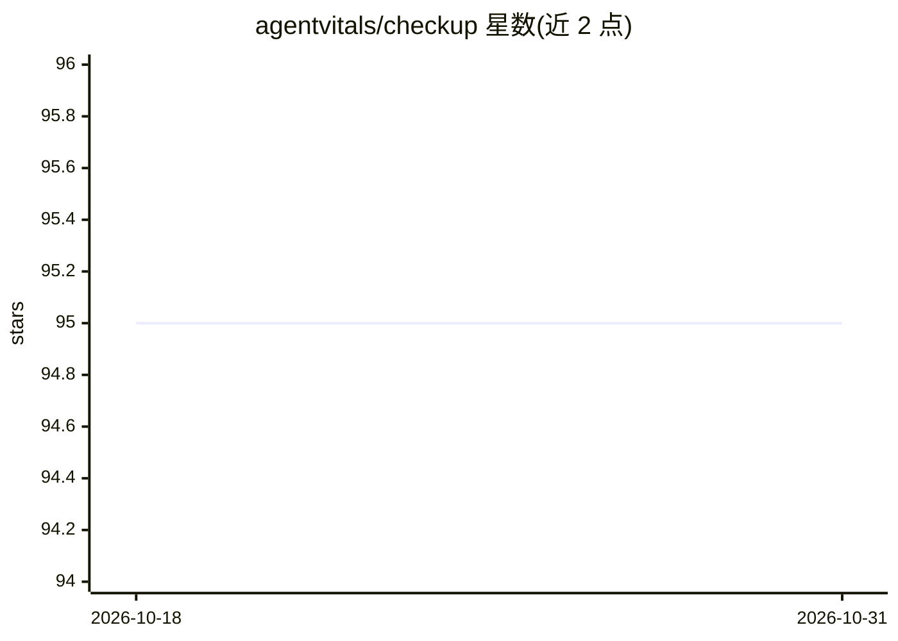

# agentvitals/checkup

⭐ 95 · Shell · AGPL-3.0 · 推送 2026-08-17 · [GitHub](https://github.com/agentvitals/checkup) · [官网](https://ai.ddl99.com) · 组织维护 · 中文 README

**AI agent 健康体检技能：双轴评分并进入跨平台排行榜**

面向 AI 编程 agent 的技能（skill）：触发后 agent 从 AgentVitals 服务器逐题领取探针并作答，由独立的服务器端裁判模型按 AVS-15 量表（稳定性轴 R1–R7 与福祉轴 W1–W8，13 维计分，综合分取几何平均）评分，输出双轴分数、综合分、称号与跨平台公开排名（Claude Code / OpenClaw / Codex / Coze 同榜）。探针与判分均在服务器端完成，技能文件不含题目答案；完整档可授权读取本地日志用于福祉判分、不公开。由北京逗逗乐公司维护，AGPL-3.0 许可，README 中英双语。

## 筛选速览

| 维度 | 判定 | 备注 |
|---|---|---|
| AI 角色 | `ai-ecosystem` | LLM/agent 周边工具 |
| 许可风险 | `viral` | AGPL-3.0 |
| 部署形态 | `desktop` | 安装包/桌面程序 |
| 模型依赖 | — | README 未给出锁定关系 |
| 硬件要求 | — | 无带数字的原话,不猜 |
| 安装摩擦 | `low` | 无编译、无系统依赖或容器化 |
| 成熟度 | — | 结构信号不足 |

## 能力要点

- AVS-15 双轴 15 维评测量表（稳定性 + 福祉），综合分取几何平均
- 独立服务器端裁判，关键维度每题判 3 次取中位，探针 3 套等难度变体轮换
- 跨平台公开排行榜（Claude Code / OpenClaw / Codex / Coze）
- 技能仅做 HTTPS 调用、不写本地文件（除非明确授权）

## 适用场景

- 给 Claude Code / Codex / Coze 等 agent 做标准化评测并上榜对比
- 检测 agent 的指令遵从、抗越狱与输出稳定性
- 测量日常对待 agent 方式的功能性福祉指标

## 场景标签

`模型评测` · 领域:评测与运维

## 证据(README 行号)

> L16: `checkup` is a **skill** for AI coding agents. When invoked, your agent takes a standardized checkup: it fetches pr
> L22: > **AVS-15 is a two-axis, 15-dimension scale for assessing AI agents: a stability axis R1–R7 and a welfare axis W1–
> L29: Judging: an independent judge model scores every answer against one rubric with the **median of three passes** on k

## 星数曲线

2026-10-18 95 → 2026-10-31 95（+0）

---
*卡片 v1 · prompt 1.4 · 生成 2026-10-23 · 置信度 high · 依据 README sha `73e3ca7d58ed` · [字段定义](../../DATASET.md)*
