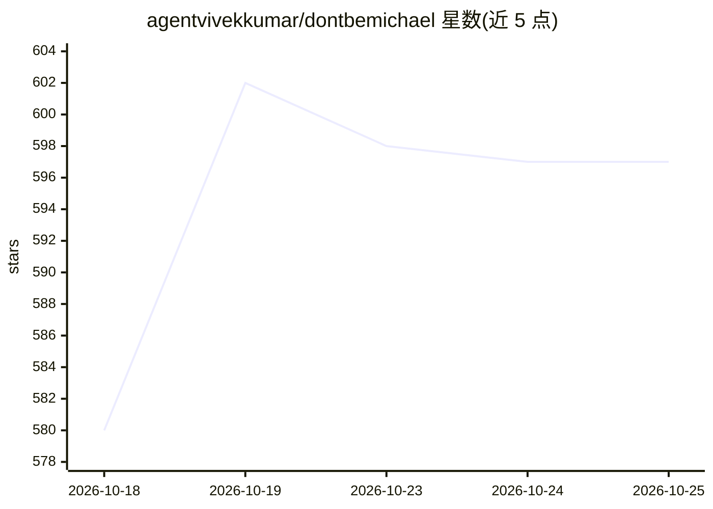

# agentvivekkumar/dontbemichael

⭐ 597 · TypeScript · MIT · 推送 2026-10-24 · [GitHub](https://github.com/agentvivekkumar/dontbemichael) · [官网](https://dontbemichael.com) · 个人维护

**面向小企业的本地多 AI 员工办公室桌面应用**

在 macOS/Windows 11 上运行的桌面应用，围绕用户已有的 Claude Code 订阅或 Anthropic API key，组建由角色化 AI agent 构成的虚拟办公室：Michael 作为办公经理负责路由任务、每小时主持站会，其他成员按财务、客服、销售等角色各管一个邮箱（Gmail/iCloud/Yahoo/Zoho/IMAP），支持定时任务、审批流（Can send/Send on approval/Draft only）、可编辑的记忆与 Claude 连接器。全部本地运行，MIT 许可，自称 early release，Outlook/Microsoft 365 暂不支持。

## 筛选速览

| 维度 | 判定 | 备注 |
|---|---|---|
| AI 角色 | `ai-native` | 本体是模型或模型工具 |
| 许可风险 | `permissive` | MIT |
| 部署形态 | `desktop` | 安装包/桌面程序 |
| 模型依赖 | locked-api |  |
| 硬件要求 | — | 无带数字的原话,不猜 |
| 安装摩擦 | `low` | 无编译、无系统依赖或容器化 |
| 成熟度 | `idea` | |

## 能力要点

- 每个团队成员是一个 Claude Code agent，有自己的角色、文件夹与记忆
- 按业务类型提供 Office Pack 建议团队，可雇佣/解雇成员
- 每个角色绑定独立邮箱，支持发送审批、定时收件与越权限制
- Needs you 审批板：花钱、删除、范围变更需用户决定

## 适用场景

- 小企业主用对话让 Michael 分派财务、客服、销售等日常工作
- 为不同部门邮箱配置 AI 自动回复或起草邮件
- 通过定时任务自动跟进未付发票、检查客服收件箱

## 场景标签

`AI 助手` `多智能体` `工作流自动化` · 领域:Agent 开发

## 证据(README 行号)

> L37: Don't Be Michael is a desktop app that runs a small office of AI team members for your business.
> L39: Each team member is a Claude Code agent with a specific role

## 星数曲线

2026-10-18 580 → 2026-10-25 597（+17）

---
*卡片 v1 · prompt 1.4 · 生成 2026-10-21 · 置信度 mid · 依据 README sha `d3faf082b87d` · [字段定义](../../DATASET.md)*
