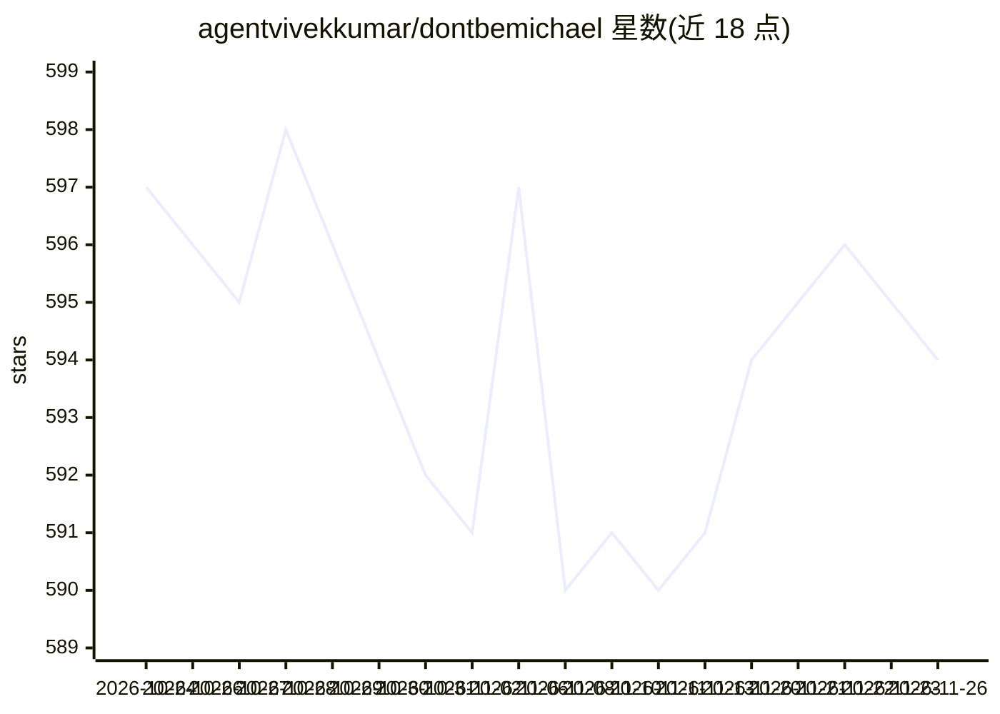

# agentvivekkumar/dontbemichael

⭐ 594 · TypeScript · MIT · 推送 2026-11-21 · [GitHub](https://github.com/agentvivekkumar/dontbemichael) · [官网](https://dontbemichael.com) · 个人维护

**给小企业的本地多 Agent 办公室：用现有 Claude 订阅跑一支 AI 团队**

桌面应用，在本机运行一支由 Claude Code agent 组成的虚拟办公室：按业务类型从 Office Pack 建议团队（财务、客服、销售、市场等），Michael 作为办公室经理负责分派任务、汇总决策。每个成员有独立文件夹与记忆，绑定各自的邮箱（Gmail/IMAP 等），支持定时任务、审批发送、草稿模式与循环熔断。依赖用户已有的 Claude 订阅或 Anthropic API key；Outlook/Microsoft 365 暂不支持。提供 macOS 与 Windows 安装包，状态为早期发布。

## 筛选速览

| 维度 | 判定 | 备注 |
|---|---|---|
| AI 角色 | `ai-native` | 本体是模型或模型工具 |
| 许可风险 | `permissive` | MIT |
| 部署形态 | `desktop` | 安装包/桌面程序 |
| 模型依赖 | locked-api |  |
| 硬件要求 | — | 无带数字的原话,不猜 |
| 安装摩擦 | `low` | 无编译、无系统依赖或容器化 |
| 成熟度 | `idea` | |

## 能力要点

- 多 agent 办公室结构：经理 Michael 路由任务，各部门各占一个 pod
- 每个成员绑定独立邮箱，支持审批发送/草稿/免审白名单三种出信方式
- 每个成员的持久记忆与后台整理合并机制
- 全部在本机运行，使用用户已有的 Claude 计划或 Anthropic API key

## 适用场景

- 让 AI 团队分部门接管客服、销售、财务邮箱的日常处理
- 小企业主只需对经理下指令，决策事项集中到 Needs you 面板
- 为定时任务（如每小时检查支持邮箱）配置自动化流程

## 场景标签

`多智能体` `AI 助手` · 领域:Agent 开发

## 证据(README 行号)

> L12: Every team member is an AI agent with a clear job, its own folder, and its own memory. Everything
> L35: Don't Be Michael is a desktop app that runs a small office of AI team members for your business.
> L42: Everything runs on your computer, on the Claude plan you already have. Each team member has a

## 星数曲线

2026-10-24 597 → 2026-11-26 594（-3）

---
*卡片 v1 · prompt 1.4 · 生成 2026-11-25 · 置信度 mid · 依据 README sha `7c1ad8441848` · [字段定义](../../DATASET.md)*
