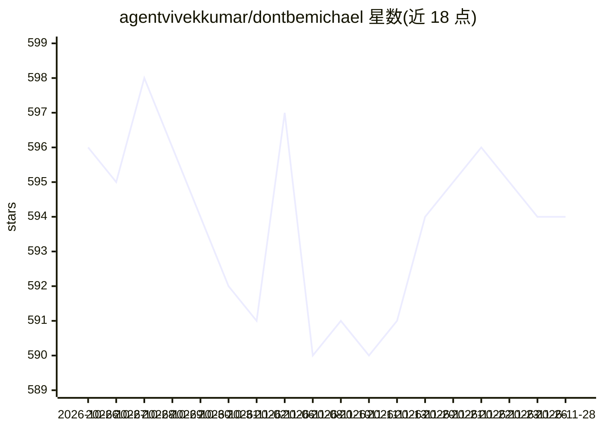

# agentvivekkumar/dontbemichael

⭐ 594 · TypeScript · MIT · 推送 2026-11-27 · [GitHub](https://github.com/agentvivekkumar/dontbemichael) · [官网](https://dontbemichael.com) · 个人维护

**为小企业主运行一支本地 AI agent 团队的桌面应用**

Don't Be Michael 是一款桌面应用，把小企业的各部门职能建成一支 AI 团队：每个成员是一个 Claude Code agent，有独立文件夹与记忆，Michael 作为主管分配工作。支持按业务类型生成起始团队、为每个成员分配邮箱（Gmail/IMAP 等）并细粒度控制发信权限（直接发/审批后发/仅草稿）、定时任务、GitHub 仓库只读或审批后推送、后台整理的长期记忆、审批看板与断路器。完全本地运行，依赖用户已有的 Claude 订阅或 Anthropic API key。支持 macOS 与 Windows 11，标注为 early release。

## 筛选速览

| 维度 | 判定 | 备注 |
|---|---|---|
| AI 角色 | `ai-native` | 本体是模型或模型工具 |
| 许可风险 | `permissive` | MIT |
| 部署形态 | `desktop` | 安装包/桌面程序 |
| 模型依赖 | locked-api |  |
| 硬件要求 | — | 无带数字的原话,不猜 |
| 安装摩擦 | `low` | 无编译、无系统依赖或容器化 |
| 成熟度 | `idea` | |

## 能力要点

- 每个团队成员是带独立文件夹、记忆与角色描述的 Claude Code agent
- 多邮箱接入（Gmail/Google Workspace/IMAP），发信权限分 Can send/Send on approval/Draft only 三级
- GitHub 仓库默认 Pull only，推送需审批或仅推到成员自己的分支
- 循环/卡死的成员会被引导、暂停、停止或重启（circuit breaker）

## 适用场景

- 让 AI 团队分摊客服、销售、财务等部门的邮件与日常事务
- 重要邮件先审批再发送，避免 agent 擅自对外沟通
- 按小时定时处理支持邮箱并汇总需要决策的事项

## 场景标签

`多智能体` `工作流自动化` `AI 助手` · 领域:Agent 开发

## 证据(README 行号)

> L35: Don't Be Michael is a desktop app that runs a small office of AI team members for your business.
> L37: Each team member is a Claude Code agent with a specific role
> L42: Everything runs on your computer, on the Claude plan you already have. Each team member has a

## 星数曲线

2026-10-26 596 → 2026-11-28 594（-2）

---
*卡片 v1 · prompt 1.4 · 生成 2026-11-28 · 置信度 mid · 依据 README sha `b4164adad946` · [字段定义](../../DATASET.md)*
