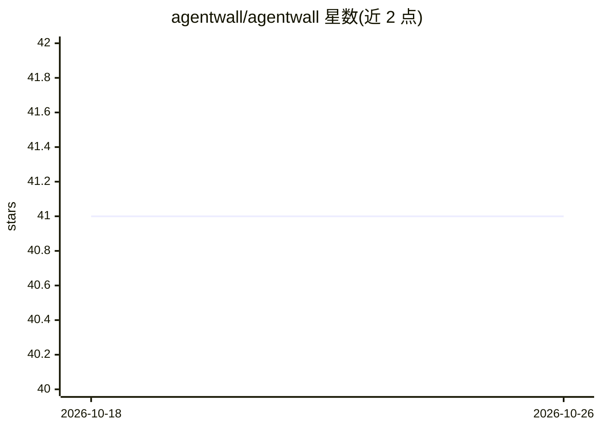

# agentwall/agentwall

⭐ 41 · TypeScript · Apache-2.0 · 推送 2026-05-24 · [GitHub](https://github.com/agentwall/agentwall) · [官网](https://agentwall.dev/) · 组织维护

**本地 AI agent 的运行时安全层：按 YAML 策略拦截工具调用**

面向在本地运行 AI agent（Claude Desktop、Cursor、Windsurf、Claude Code、OpenClaw 等 MCP 客户端）的用户，AgentWall 作为代理层位于客户端与 MCP 服务器之间，按 deny→allow→ask 顺序评估 YAML 策略，未匹配调用默认进入询问而非静默放行。机制包括污点追踪（读取敏感凭证后阻断后续外发网络调用）、限速、独立审计日志与 localhost 浏览器审批 UI。策略文件位于模型上下文窗口之外，不受上下文压缩或提示注入影响；一条命令可自动包装 MCP 配置并可用 undo 还原。要求 Node.js >= 22。

## 筛选速览

| 维度 | 判定 | 备注 |
|---|---|---|
| AI 角色 | `ai-ecosystem` | LLM/agent 周边工具 |
| 许可风险 | `permissive` | Apache-2.0 |
| 部署形态 | `library` | 以包/库形式分发 |
| 模型依赖 | — | README 未给出锁定关系 |
| 硬件要求 | — | 无带数字的原话,不猜 |
| 安装摩擦 | `low` | 无编译、无系统依赖或容器化 |
| 成熟度 | — | 结构信号不足 |

## 能力要点

- 代理层拦截 MCP 工具调用，策略评估顺序 deny→allow→ask，未匹配默认询问
- 污点追踪：敏感文件读取后自动阻断非白名单主机的网络外发
- 自动检测并包装 Claude Desktop/Cursor/Windsurf/Claude Code/OpenClaw 的 MCP 配置，可一键还原
- 独立审计日志与 localhost 审批 UI，策略热重载无需重启

## 适用场景

- 防止本地 AI agent 误删文件、删除邮箱或执行破坏性 git 操作
- 阻断 agent 读取凭证后外传的多步数据渗出链路
- 为无终端的 GUI 客户端提供浏览器审批界面
- 留存独立于模型自述的工具调用审计记录

## 场景标签

 · 领域:AI agent 安全基础设施

## 证据(README 行号)

> L44: - **Works everywhere.** Claude Desktop, Cursor, Windsurf, Claude Code, OpenClaw, any MCP client
> L285: AgentWall sits between your AI client and every MCP server it spawns.
> L288: AI Client  ←→  AgentWall Proxy  ←→  Real MCP Server

## 星数曲线

2026-10-18 41 → 2026-10-26 41（+0）

---
*卡片 v1 · prompt 1.4 · 生成 2026-10-25 · 置信度 mid · 依据 README sha `c35359188495` · [字段定义](../../DATASET.md)*
