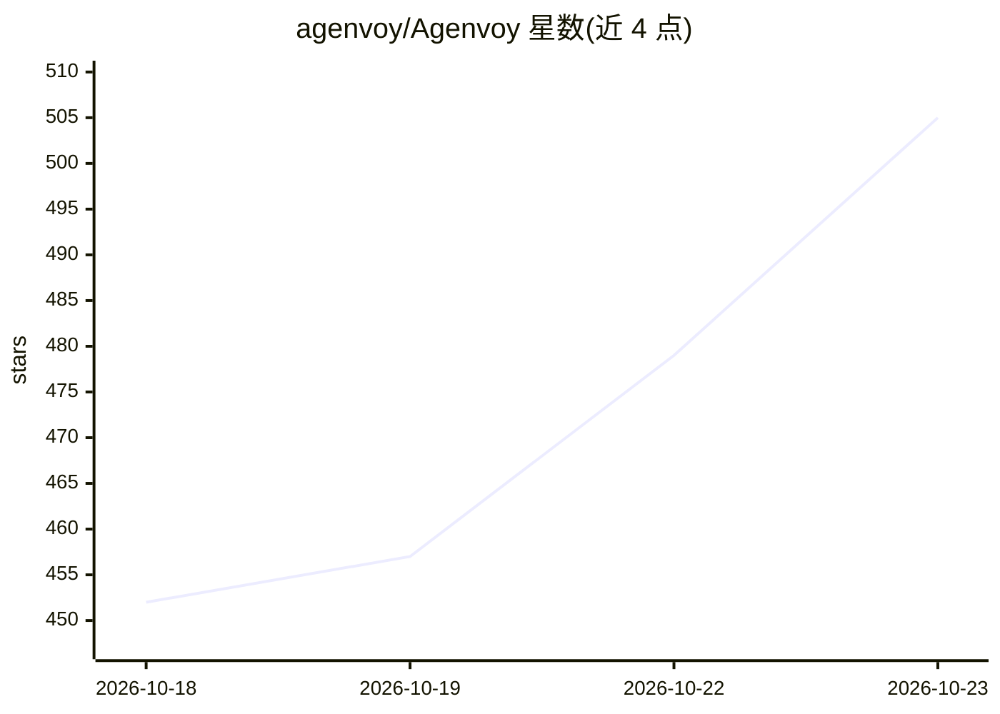

# agenvoy/Agenvoy

⭐ 505 · Go · AGPL-3.0 · 推送 2026-10-22 · [GitHub](https://github.com/agenvoy/Agenvoy) · [官网](https://agenvoy.com/) · 个人维护 · 中文 README

**本地自托管 24/7 个人 AI 代理运行器（Go 单二进制）**

用 Go 编写、单二进制分发的自托管个人 AI agent harness：将请求拆解为步骤、调用工具并交付结果，支持自动生成缺失工具、一句话创建定时任务、长期记忆、本地文件 RAG 检索、子代理协作与执行失败后自修复。作为 MCP 客户端连接外部 MCP 服务，同时作为 MCP server 向 Claude Code、Codex 等代理共享沙箱化工具。内置 Web 控制面板，经 Telegram/Discord 出站连接远程访问，记忆与凭据保留在本机。macOS/Linux 提供一行脚本安装，Windows 经 WSL 安装。

## 筛选速览

| 维度 | 判定 | 备注 |
|---|---|---|
| AI 角色 | `ai-ecosystem` | LLM/agent 周边工具 |
| 许可风险 | `dual` | AGPL-3.0 |
| 部署形态 | `None` |  |
| 模型依赖 | — | README 未给出锁定关系 |
| 硬件要求 | — | 无带数字的原话,不猜 |
| 安装摩擦 | `low` | 无编译、无系统依赖或容器化 |
| 成熟度 | — | 结构信号不足 |

## 能力要点

- 缺失工具时自动创建、测试并保存供复用
- 既是 MCP 客户端也是 MCP server，向 Claude Code/Codex 共享工具库
- 单句创建定时任务，守护进程 24/7 运行
- 内置 Web 面板（127.0.0.1:17989）与 Telegram/Discord 出站通道

## 适用场景

- 把调研、文件整理、周期性汇报转为可复用的自动化
- 让 Claude Code、Codex 等代理共享同一套沙箱化工具
- 通过 Telegram/Discord 私有通道远程操控本机 agent

## 场景标签

`Agent 框架` `Agent 记忆` `多智能体` `AI 助手` · 领域:Agent 开发

## 证据(README 行号)

> L5:  Agenvoy is an open-source, self-hosted 24/7 personal AI agent that runs on your own computer — your memory, schedul
> L19: Agenvoy is a Taiwan-developed AI Agent Harness by Pardn Chiu, built to turn conversation into completed work on you
> L103: > Agenvoy is also an MCP server.

## 星数曲线

2026-10-18 452 → 2026-10-23 505（+53）

---
*卡片 v1 · prompt 1.4 · 生成 2026-10-21 · 置信度 high · 依据 README sha `df24ce8b7e70` · [字段定义](../../DATASET.md)*
