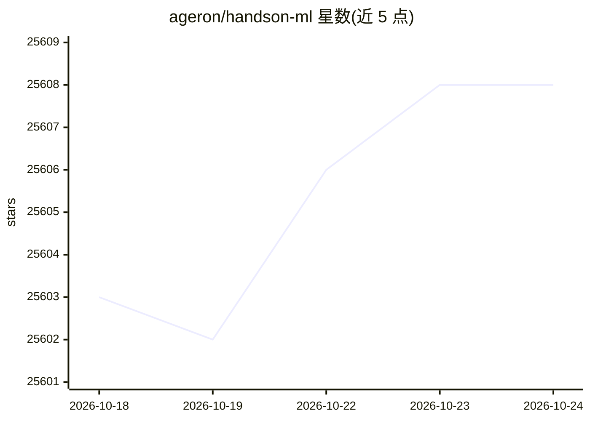

# ageron/handson-ml

⭐ 25,608 · Jupyter Notebook · Apache-2.0 · 推送 2026-05-19 · [GitHub](https://github.com/ageron/handson-ml) · 个人维护

**机器学习入门者的 Python 笔记本练习集（第一版，已过时）**

配套 O'Reilly《Hands-on Machine Learning with Scikit-Learn and TensorFlow》第一版的 Jupyter 笔记本项目，提供书中示例代码与习题解答，用于教授 Python 机器学习基础。维护者声明该项目已过时（2017 年出版），README 顶部指向第三版 handson-ml3 与 PyTorch 版 handson-mlp。安装方式包括 Colaboratory/Binder/Deepnote 在线运行、Docker 镜像、或本地 Anaconda 环境克隆运行。

## 筛选速览

| 维度 | 判定 | 备注 |
|---|---|---|
| AI 角色 | `ai-knowledge` | 知识聚合/清单类 |
| 许可风险 | `permissive` | Apache-2.0 |
| 部署形态 | `None` |  |
| 模型依赖 | — | README 未给出锁定关系 |
| 硬件要求 | — | 无带数字的原话,不猜 |
| 安装摩擦 | `medium` | 含编译或系统依赖之一 |
| 成熟度 | — | 结构信号不足 |

## 动量与使用信号

- 维护:`maintenance` — 距上次 push 151.4 天,年发版 0,36 位贡献者
- 涨星:近 1 天 **-1**(自 20261016 起算)
- 安装:github 包 `release-assets` 月下载无数据

## 能力要点

- 包含书籍示例代码与习题解答的 Jupyter 笔记本
- 支持 Colaboratory、Binder、Deepnote 在线运行
- 提供 Docker 镜像与 Anaconda 环境两种本地运行途径
- 维护者声明已过时并指向新版项目

## 适用场景

- 按第一版书籍学习机器学习基础
- 在线笔记本环境中直接运行示例代码
- 本地搭建 conda 环境跑书中练习

## 场景标签

`教程课程` · 领域:学习与行业

## 证据(README 行号)

> L7: This project aims at teaching you the fundamentals of Machine Learning in
> L8: python. It contains the example code and solutions to the exercises in my O'Reilly book Hands-on Machine Learning wi
> L5: This project is for the first edition, which is now outdated (it came out in 2017).

## 星数曲线

2026-10-18 25,603 → 2026-10-24 25,608（+5）

---
*卡片 v1 · prompt 1.4 · 生成 2026-10-18 · 置信度 high · 依据 README sha `376c3879b5e9` · [字段定义](../../DATASET.md)*
