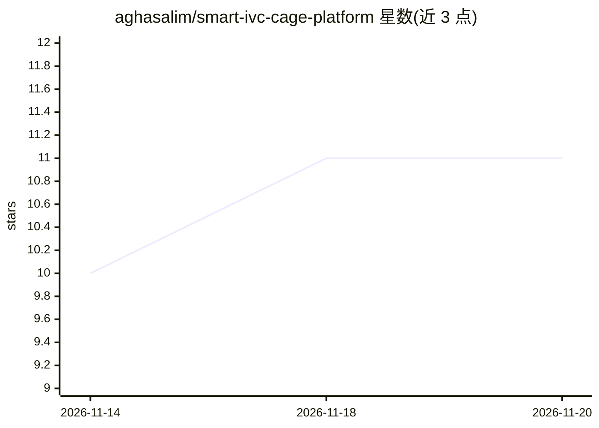

# aghasalim/smart-ivc-cage-platform

⭐ 11 · Python · MIT · 推送 2026-11-11 · [GitHub](https://github.com/aghasalim/smart-ivc-cage-platform) · 组织维护

**实验动物 IVC 智能笼的软件平台：传感、喂水与行为分类**

为配备传感器的独立通气饲养笼（IVC）提供软件平台，运行在笼旁的 Raspberry Pi 5 上，覆盖喂食、容积式给水、称重、气体分析、摄像头流与行为分类推理。后端 FastAPI+SQLite+WebSocket，前端 React PWA，固件跑在 Arduino Mega 2560，通过 Cloudflare Tunnel 实现无入站端口部署，systemd 定时拉取式自动重部署。行为分类基于 scikit-learn，训练数据来自手工编写的合成生成器，作者明确说明 0.996 F1 不代表对真实小鼠的准确率。支持 CSV/JSON/XLSX/PDF/DOCX 导出。

## 筛选速览

| 维度 | 判定 | 备注 |
|---|---|---|
| AI 角色 | `ai-enhanced` | 去掉 AI 部分产品仍成立 |
| 许可风险 | `permissive` | MIT |
| 部署形态 | `self-host` | docker 或自建部署 |
| 模型依赖 | — | README 未给出锁定关系 |
| 硬件要求 | — | 无带数字的原话,不猜 |
| 安装摩擦 | `low` | 无编译、无系统依赖或容器化 |
| 成熟度 | — | 结构信号不足 |

## 能力要点

- 闭环/开环给水剂量控制：流量计计数、coast 体积补偿、电磁阀防虹吸
- 设备模拟器使全平台可在无硬件下端到端运行
- Cloudflare Tunnel 无入站端口 + 仅拉取式自动部署（60 秒内）
- 4 语言 PWA 面板与多格式流式数据导出

## 适用场景

- 实验动物设施远程查看笼内传感器、水量与实时影像
- 对小鼠红外录像做行为窗口分类与位置热图追踪
- 将传感器数据导出后直接接入 R 或 SPSS 分析

## 场景标签

`科研工具` · 领域:学习与行业

## 证据(README 行号)

> L9: This is the software for an instrumented individually ventilated cage (IVC), the
> L11: weighing, gas analysis, cameras and behaviour classification. It all runs on a
> L218: |inference|scikit-learn (behaviour), MAD-based streaming anomaly detector|

## 星数曲线

2026-11-14 10 → 2026-11-20 11（+1）

---
*卡片 v1 · prompt 1.4 · 生成 2026-11-18 · 置信度 mid · 依据 README sha `6fda307ab980` · [字段定义](../../DATASET.md)*
