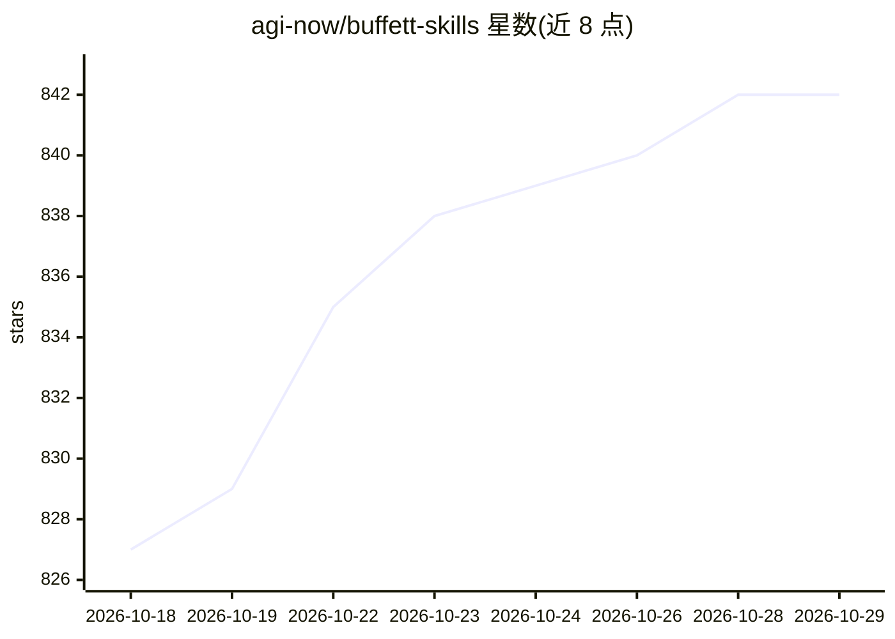

# agi-now/buffett-skills

⭐ 842 · 推送 2026-04-13 · [GitHub](https://github.com/agi-now/buffett-skills) · [官网](https://www.aitroop.net/) · 组织维护 · 中文 README

**巴菲特投资框架的 Claude Code 技能集合**

一套基于沃伦·巴菲特投资框架构建的 Claude Code skills：核心为 buffett 技能，在用户进行股票分析、投资决策、财报阅读、护城河判断等场景时自动触发。采用渐进式披露机制，SKILL.md 常驻加载，8 个参考文件（思维框架、投资哲学、商业模式、财务指标、估值等）按分析类型按需读取。提供 3 条路径的调度逻辑与结构化输出模板，参考内容编译自 49 个巴菲特信件概念页，并附 3 个测试用例的评测结果。

## 筛选速览

| 维度 | 判定 | 备注 |
|---|---|---|
| AI 角色 | `ai-knowledge` | 知识聚合/清单类 |
| 许可风险 | `none` | — |
| 部署形态 | `None` |  |
| 模型依赖 | — | README 未给出锁定关系 |
| 硬件要求 | — | 无带数字的原话,不猜 |
| 安装摩擦 | `low` | 无编译、无系统依赖或容器化 |
| 成熟度 | — | 结构信号不足 |

## 能力要点

- 投资分析与商业质量问题自动触发，无需提及 Buffett
- 渐进式披露：SKILL.md 常驻 + 8 个参考文件按需读取
- 三条调度路径：快速筛选 / 深度分析 / 主题提问
- 结构化输出模板（结论、能力圈、估值、卖出标准等 10 项必填）

## 适用场景

- 让 Claude Code 按巴菲特框架做股票或公司分析
- 价值投资概念问答（复利、内在价值、安全边际等）
- 生成结构化的买入/持有/卖出决策分析

## 场景标签

`金融量化` · 领域:学习与行业

## 证据(README 行号)

> L5: A collection of Claude Code skills built around Warren Buffett's investment framework.
> L51: The `buffett` skill uses **progressive disclosure**: `SKILL.md` is always loaded, and the 8 reference files are rea

## 星数曲线

2026-10-18 827 → 2026-10-29 842（+15）

---
*卡片 v1 · prompt 1.4 · 生成 2026-10-21 · 置信度 high · 依据 README sha `340b704ddb6b` · [字段定义](../../DATASET.md)*
