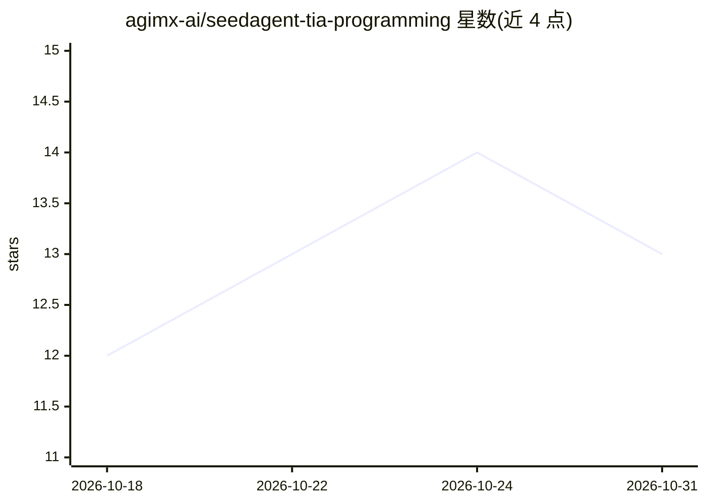

# agimx-ai/seedagent-tia-programming

⭐ 13 · 推送 2026-10-12 · [GitHub](https://github.com/agimx-ai/seedagent-tia-programming) · 组织维护 · 中文 README

**西门子 TIA Portal 工控 AI 编程智能体：自然语言生成 SCL 并编译下载**

面向 S7-1200/S7-1500 与 TIA Portal V16–V21 的闭源商业 AI 编程智能体（v0.9.0），适配腾讯 WorkBuddy 客户端。自控工程师通过自然语言在本机或远程工程机上完成 SCL 代码生成（FB/FC/DB 块）、工程打开与 .zap 归档恢复导出、驱动真实 TIA 编译器排错、PLCSIM Advanced 仿真及经二次确认的真实 PLC 下载；底层封装 Openness 接口，并内置项目保护与确认边界。运行服务按单项能力计费（SkillPay/微信支付），仓库仅做产品介绍不含源代码。当前不支持梯形图、WinCC Unified 与硬件组态修改。

## 筛选速览

| 维度 | 判定 | 备注 |
|---|---|---|
| AI 角色 | `ai-native` | 本体是模型或模型工具 |
| 许可风险 | `none` | — |
| 部署形态 | `None` |  |
| 模型依赖 | — | README 未给出锁定关系 |
| 硬件要求 | — | 无带数字的原话,不猜 |
| 安装摩擦 | `low` | 无编译、无系统依赖或容器化 |
| 成熟度 | — | 结构信号不足 |

## 能力要点

- 自然语言生成标准 SCL 代码并自动创建 FB/FC/DB 块
- 驱动真实 TIA Portal 编译器执行编译并返回实际报错
- 支持 .zap16–.zap21 归档恢复/导出与 PLCSIM Advanced 仿真下载
- 真实 PLC 下载执行工程/项目/IP/接口二次确认机制

## 适用场景

- 用自然语言编写电机启停、Modbus 轮询等 S7-1200/1500 程序
- 打开历史 .ap 工程或恢复 .zap 归档并继续修改、重新归档
- 编译报错后由 AI 针对性排错修复
- 先下载到 PLCSIM Advanced 仿真验证再确认下载真实 PLC

## 场景标签

`代码生成` `编码 Agent` · 领域:编码与开发

## 证据(README 行号)

> L3: > **面向 Siemens S7-1200 / S7-1500 的工控 AI 编程助手**：通过自然语言生成西门子 SCL 代码、项目批量修改、语法编译排错、工程归档（.zap）与安全下载。适配腾讯 WorkBuddy。
> L11: 通过 **SeedAgent 西门子博途（TIA Portal / 行业常称“博图”）编程智能体**，一套面向 **Siemens S7-1200、S7-1500 和 TIA Portal V16～V21** 的工控 AI 工程扩

## 星数曲线

2026-10-18 12 → 2026-10-31 13（+1）

---
*卡片 v1 · prompt 1.4 · 生成 2026-10-31 · 置信度 high · 依据 README sha `13afe40b3f3c` · [字段定义](../../DATASET.md)*
