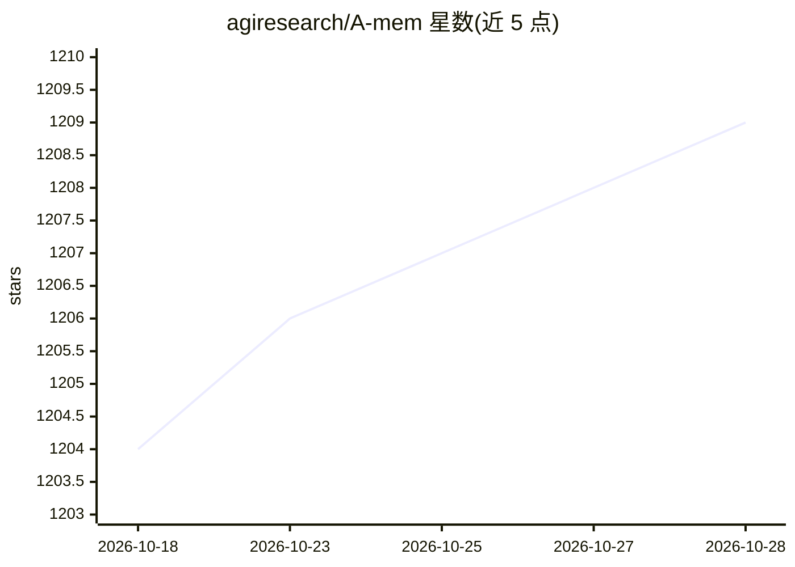

# agiresearch/A-mem

⭐ 1,209 · Python · MIT · 推送 2025-12-12 · [GitHub](https://github.com/agiresearch/A-mem) · 组织维护

**LLM Agent 的智能体记忆系统，动态组织与演化记忆**

为 LLM Agent 提供的记忆系统库：新记忆写入时自动生成结构化笔记、标签与上下文，分析历史记忆并建立语义链接，支持记忆的持续演化与更新；基于 Zettelkasten 原则组织，用 ChromaDB 做向量索引与检索。支持 OpenAI 与 Ollama 两类 LLM 后端。以 Python 包形式提供（git clone 后 pip install），论文复现代码在另一仓库。

## 筛选速览

| 维度 | 判定 | 备注 |
|---|---|---|
| AI 角色 | `ai-ecosystem` | LLM/agent 周边工具 |
| 许可风险 | `permissive` | MIT |
| 部署形态 | `library` | 以包/库形式分发 |
| 模型依赖 | local-ok | 支持本地模型 |
| 硬件要求 | — | 无带数字的原话,不猜 |
| 安装摩擦 | `low` | 无编译、无系统依赖或容器化 |
| 成熟度 | — | 结构信号不足 |

## 能力要点

- 基于 Zettelkasten 原则的动态记忆组织
- ChromaDB 向量存储与语义相似检索
- 记忆自动演化：更新标签、上下文并建立语义连接
- 支持 OpenAI（GPT-4/GPT-3.5）与 Ollama 本地部署后端

## 适用场景

- 为 LLM Agent 构建可积累历史经验的长期记忆
- 需要语义检索与自动关联的知识/记忆管理
- 本地部署（Ollama）场景下的 Agent 记忆方案

## 场景标签

`Agent 记忆` · 领域:Agent 开发

## 证据(README 行号)

> L3: A novel agentic memory system for LLM agents that can dynamically organize memories in an agentic way.
> L16: > **Note:** This repository provides a memory system to facilitate agent construction. If you want to reproduce the

## 星数曲线

2026-10-18 1,204 → 2026-10-28 1,209（+5）

---
*卡片 v1 · prompt 1.4 · 生成 2026-10-21 · 置信度 high · 依据 README sha `528b0d540f72` · [字段定义](../../DATASET.md)*
