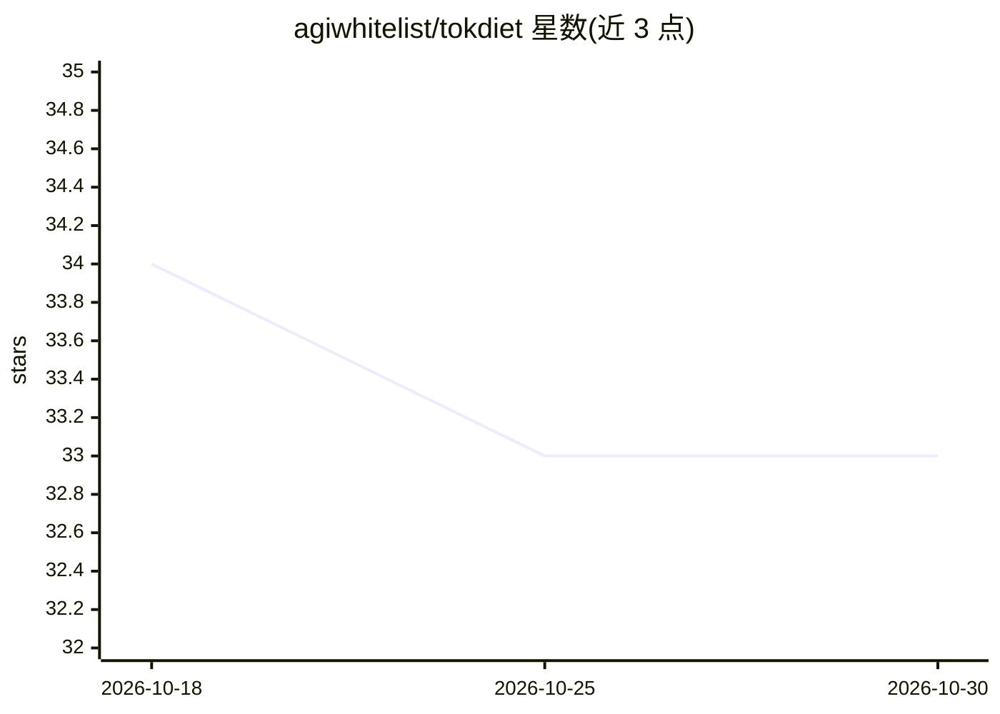

# agiwhitelist/tokdiet

⭐ 33 · TypeScript · MIT · 推送 2026-06-18 · [GitHub](https://github.com/agiwhitelist/tokdiet) · [官网](https://agiwhitelist.github.io/tokdiet/) · 个人维护

**本地反向代理：计量 AI 编程代理的 token 成本并压缩上下文**

运行于 AI 编程代理（Claude Code、Cursor、Codex）与模型 API（Anthropic、OpenAI、Gemini、MiniMax）之间的本地流式反向代理：逐请求计量 token 与美元成本，以去重、省略、中间摘要三种策略压缩膨胀上下文（README 报告 −71% token、66 任务 A/B 基准质量 63/66 对 64/66）。以 shadow-eval 抽样复测与质量预算（默认 2% 上限）触发 safe-mode 控制质量；缓存前缀与 signed thinking 块不被改写，故障时回退透明转发。通过 npx 运行或作为 Claude Code 插件安装，API key 不落盘。限制：订阅制下无按 token 费可省，价值仅为计量与仪表盘。

## 筛选速览

| 维度 | 判定 | 备注 |
|---|---|---|
| AI 角色 | `ai-ecosystem` | LLM/agent 周边工具 |
| 许可风险 | `permissive` | MIT |
| 部署形态 | `library` | 以包/库形式分发 |
| 模型依赖 | locked-api |  |
| 硬件要求 | — | 无带数字的原话,不猜 |
| 安装摩擦 | `low` | 无编译、无系统依赖或容器化 |
| 成熟度 | — | 结构信号不足 |

## 能力要点

- 流式 SSE 反向代理，逐请求计量 token 与美元成本
- 上下文按虚拟内存方式页出（SQLite 可恢复），非直接删除
- shadow-eval 复测 + 质量预算（默认 2%）触发 per-strategy safe-mode
- 缓存感知（cache_control 前缀不压缩）与 thinking 块安全不改写

## 适用场景

- 让 Claude Code/Cursor 等代理的流量过代理以削减按 token 计费 API 支出
- 实时查看会话、工具与仓库维度的 token 成本仪表盘
- 压缩膨胀上下文同时核验回答质量未下降

## 场景标签

`模型网关` `LLM 可观测性` · 领域:Agent 开发

## 证据(README 行号)

> L3: **Your AI agent is paying to send the same file dump five times.** `tokdiet` is a local proxy that sits between your
> L51: export ANTHROPIC_BASE_URL=http://localhost:7787
> L52: export OPENAI_BASE_URL=http://localhost:7787/v1

## 星数曲线

2026-10-18 34 → 2026-10-30 33（-1）

---
*卡片 v1 · prompt 1.4 · 生成 2026-10-25 · 置信度 high · 依据 README sha `03c3d062f97f` · [字段定义](../../DATASET.md)*
