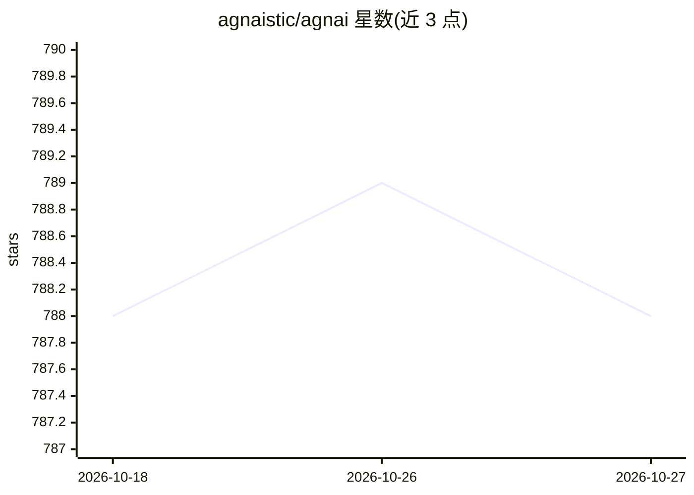

# agnaistic/agnai

⭐ 788 · TypeScript · AGPL-3.0 · 推送 2026-06-15 · [GitHub](https://github.com/agnaistic/agnai) · [官网](https://agnai.chat) · 组织维护

**多用户多角色的 AI 角色扮演聊天自托管平台**

基于 Node.js/TypeScript（SolidJS 前端）的 AI 角色扮演聊天应用：支持群组对话中多用户与多 bot，可接入 Kobold、Novel、AI Horde、Goose、OpenAI、Claude、Replicate、OpenRouter、Mancer 等多种 AI 服务。提供多租户（用户认证、个人 AI 服务设置、订阅）、记忆/Lorebook、AI 生成角色、第三方图像生成，以及长期记忆与 Wikipedia/PDF 嵌入等可选管线功能。MongoDB 与 Redis 为可选，缺失时以访客/匿名模式运行。支持 npm 全局安装、源码运行与 Docker 自托管。

## 筛选速览

| 维度 | 判定 | 备注 |
|---|---|---|
| AI 角色 | `ai-native` | 本体是模型或模型工具 |
| 许可风险 | `viral` | AGPL-3.0 |
| 部署形态 | `self-host` | docker 或自建部署 |
| 模型依赖 | locked-api |  |
| 硬件要求 | — | 无带数字的原话,不猜 |
| 安装摩擦 | `low` | 无编译、无系统依赖或容器化 |
| 成熟度 | — | 结构信号不足 |

## 能力要点

- 支持 9 种 AI 服务接入（Kobold、OpenAI、Claude、OpenRouter 等）
- 多租户：用户认证、各用户独立 AI 服务设置与生成预设
- 记忆/Lorebook、AI 生成角色、第三方图像生成
- 可选长期记忆与 Wikipedia/PDF 嵌入管线

## 适用场景

- 自托管一个多用户 AI 角色扮演聊天站点
- 与个性化虚构角色进行群组对话
- 按用户分配不同 AI 服务与生成预设

## 场景标签

`聊天机器人` · 领域:对话与助手

## 证据(README 行号)

> L3: > AI Roleplay Chat with Personalized Characters using your favorite AI services.
> L33: - **Multiple AI services**: Support for Kobold, Novel, AI Horde, Goose, OpenAI, Claude, Replicate, OpenRouter, Manc

## 星数曲线

2026-10-18 788 → 2026-10-27 788（+0）

---
*卡片 v1 · prompt 1.4 · 生成 2026-10-21 · 置信度 high · 依据 README sha `28e84bf3f608` · [字段定义](../../DATASET.md)*
