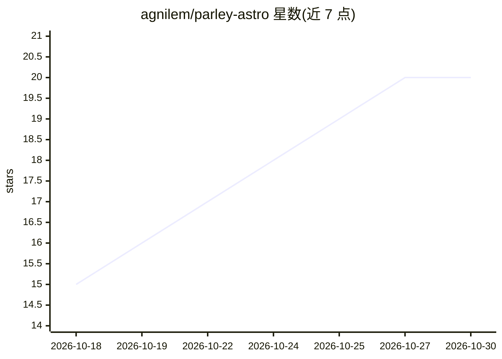

# agnilem/parley-astro

⭐ 20 · CSS · MIT · 推送 2026-10-13 · [GitHub](https://github.com/agnilem/parley-astro) · [官网](https://parley.startfrom.co) · 组织维护

**面向 AI/SaaS 初创的网站模板（Astro 与 Next.js 双版本）**

MIT 许可的静态网站模板，为 AI agent 与 SaaS 产品提供落地页、定价页、工作流页、博客（10 篇 Markdown 文章）、联系/等候名单表单等 22 个页面。基于 Astro 7 静态输出，附带的 Next.js 16 版本由脚本从 Astro 源码生成，并用工具逐元素比对两版构建。含 12 个色彩 token 与 16 级字阶的设计系统，支持 prefers-reduced-motion 降级、可选 Sveltia CMS 管理界面、Vercel 一键部署。模板本身不含 AI 功能，需接入自己的表单、统计与服务。

## 筛选速览

| 维度 | 判定 | 备注 |
|---|---|---|
| AI 角色 | `ai-enhanced` | 去掉 AI 部分产品仍成立 |
| 许可风险 | `permissive` | MIT |
| 部署形态 | `library` | 以包/库形式分发 |
| 模型依赖 | — | README 未给出锁定关系 |
| 硬件要求 | — | 无带数字的原话,不猜 |
| 安装摩擦 | `low` | 无编译、无系统依赖或容器化 |
| 成熟度 | — | 结构信号不足 |

## 能力要点

- 22 个页面：落地页、定价、工作流、博客、表单等
- Astro 7 与 Next.js 16 双版本，脚本自动生成并逐元素比对
- 可选 Sveltia CMS 静态管理界面（/admin/）
- 静态输出，无需环境变量即可 Vercel 部署

## 适用场景

- AI agent / SaaS 初创快速搭建产品官网
- 带博客与定价页的静态营销站点
- 需要 Astro 或 Next.js 两种技术栈可选的落地页起点

## 场景标签

 · 领域:Web 开发/网站模板

## 证据(README 行号)

> L18: A modern AI agent template built on one idea: AI that works with you, not
> L64: Parley is a template and demonstration brand. Connect your own forms,

## 星数曲线

2026-10-18 15 → 2026-10-30 20（+5）

---
*卡片 v1 · prompt 1.4 · 生成 2026-10-28 · 置信度 mid · 依据 README sha `44a6d5afaf13` · [字段定义](../../DATASET.md)*
