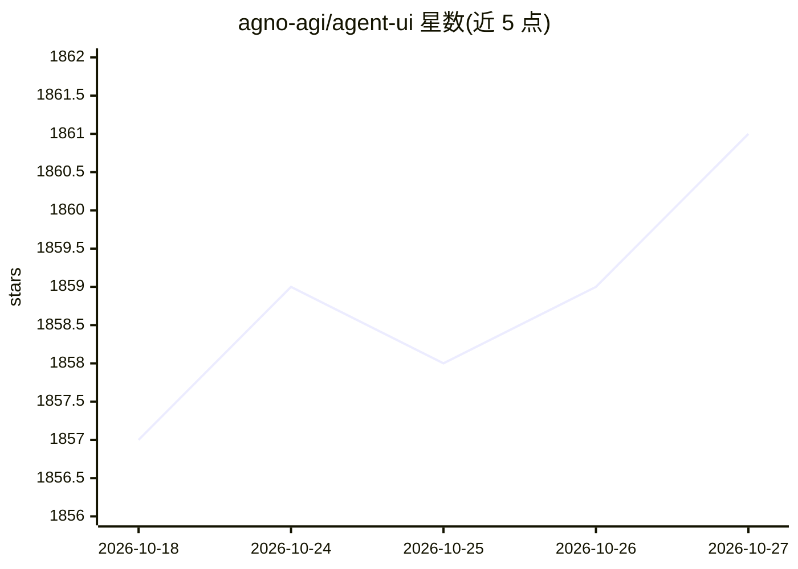

# agno-agi/agent-ui

⭐ 1,861 · TypeScript · MIT · 推送 2026-05-08 · [GitHub](https://github.com/agno-agi/agent-ui) · [官网](https://agno-agent-ui.vercel.app) · 组织维护

**连接 AgentOS 的 Next.js 聊天界面模板**

基于 Next.js、Tailwind CSS 与 TypeScript 构建的聊天界面模板，用于连接本地或生产环境的 AgentOS 实例，通过 Agno 平台与 agent 交互。支持实时流式输出、工具调用结果可视化、推理步骤与引用来源展示、多模态内容（图像/视频/音频）显示。提供 npx create-agent-ui 自动安装与 git clone 手动安装两种方式，可配置端点 URL 与可选的 Bearer 认证令牌。使用前需有运行中的 AgentOS 实例。

## 筛选速览

| 维度 | 判定 | 备注 |
|---|---|---|
| AI 角色 | `ai-ecosystem` | LLM/agent 周边工具 |
| 许可风险 | `permissive` | MIT |
| 部署形态 | `library` | 以包/库形式分发 |
| 模型依赖 | — | README 未给出锁定关系 |
| 硬件要求 | — | 无带数字的原话,不猜 |
| 安装摩擦 | `low` | 无编译、无系统依赖或容器化 |
| 成熟度 | — | 结构信号不足 |

## 能力要点

- 连接本地与生产 AgentOS 实例的聊天界面
- 实时流式输出与工具调用结果可视化
- 多模态内容（图像/视频/音频）展示
- 端点可配置并支持 Bearer Token 认证

## 适用场景

- 为我的 AgentOS 实例提供自托管的聊天前端
- 在对话中查看 agent 的工具调用与推理过程
- 本地开发与生产环境连接同一 agent 界面

## 场景标签

`聊天机器人` · 领域:对话与助手

## 证据(README 行号)

> L3: A modern chat interface for AgentOS built with Next.js, Tailwind CSS, and TypeScript. This template provides a ready
> L9: - 🔗 **AgentOS Integration**: Seamlessly connect to local and live AgentOS instances

## 星数曲线

2026-10-18 1,857 → 2026-10-27 1,861（+4）

---
*卡片 v1 · prompt 1.4 · 生成 2026-10-21 · 置信度 high · 依据 README sha `fc87d99de867` · [字段定义](../../DATASET.md)*
