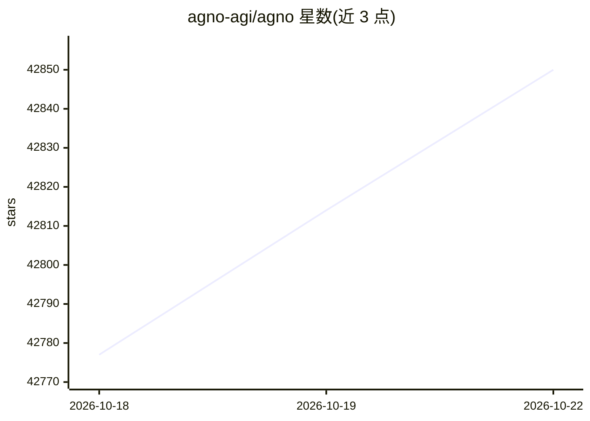

# agno-agi/agno

⭐ 42,863 · Python · Apache-2.0 · 推送 2026-10-22 · [GitHub](https://github.com/agno-agi/agno) · [官网](https://docs.agno.com) · 组织维护

**供开发者构建、运行并管理 agent 平台的框架与运行时**

Agno 提供 SDK 与 AgentOS 运行时：用 SDK 构建 agent，作为服务运行（REST API、SSE、websockets），并通过 Web UI 管理平台。数据与链路存于自有 Postgres 数据库，内置 JWT RBAC、多租户隔离、人工审批、OpenTelemetry 可观测性与定时任务。上手路径是把提示词交给编码 agent（Claude Code、Cursor 等）从模板仓库部署，也支持手写代码；模板覆盖 Railway、Docker、AWS、GCP、Azure 等部署目标。每轮 agent 运行发送遥测事件，可用 AGNO_TELEMETRY=false 关闭。

## 筛选速览

| 维度 | 判定 | 备注 |
|---|---|---|
| AI 角色 | `ai-native` | 本体是模型或模型工具 |
| 许可风险 | `permissive` | Apache-2.0 |
| 部署形态 | `None` |  |
| 模型依赖 | — | README 未给出锁定关系 |
| 硬件要求 | — | 无带数字的原话,不猜 |
| 安装摩擦 | `low` | 无编译、无系统依赖或容器化 |
| 成熟度 | — | 结构信号不足 |

## 动量与使用信号

- 维护:`active` — 距上次 push 0.9 天,年发版 100,441 位贡献者
- 涨星:近 1 天 **+15**(自 20261016 起算)
- 安装:github 包 `release-assets` 月下载无数据
- 平台:WEB · 协议:MCP

## 能力要点

- SDK 构建 + AgentOS 运行时 + Web UI 管理的组合
- 50+ 端点的生产 API，支持 SSE 与 websockets
- JWT RBAC 与多用户多租户隔离
- 100+ 预置工具集成（GitHub、Slack、Postgres 等）

## 适用场景

- 为自家产品搭建自托管的 agent 服务平台
- 用自有数据库存储会话、记忆与 traces
- 通过 Slack、Telegram、WhatsApp、Discord 等接口暴露 agent
- 在任意支持容器的云平台部署 agent 平台

## 场景标签

`Agent 框架` · 领域:Agent 开发

## 证据(README 行号)

> L11: Agno is a framework and runtime for agent platforms. Build agents, run them as a service, manage your platform usin
> L13: - Build your agent platform using the Agno SDK.
> L14: - Run your agent platform using the AgentOS runtime.

## 星数曲线

2026-10-18 42,777 → 2026-10-22 42,850（+73）

---
*卡片 v1 · prompt 1.4 · 生成 2026-10-18 · 置信度 high · 依据 README sha `d784a97ad617` · [字段定义](../../DATASET.md)*
