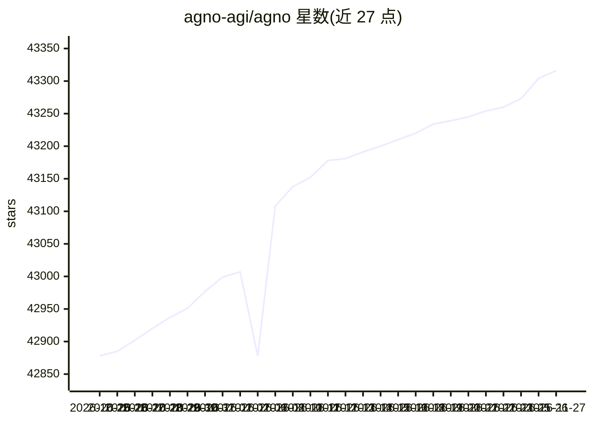

# agno-agi/agno

⭐ 43,316 · Python · Apache-2.0 · 推送 2026-11-26 · [GitHub](https://github.com/agno-agi/agno) · [官网](https://docs.agno.com) · 组织维护

**自管理 Agent 平台：构建并托管企业 Agent 服务**

Agno 提供围绕 Agent 的编排与服务层：通过 Agno/Claude Agent/Codex SDK 构建 Agent 并组合为团队与工作流，以持久化服务形式运行在 AgentOS 上，内置 API 与 MCP server、鉴权、角色访问、恢复/重放、人工审批、调度与可观测性。平台可部署在自有云，通过 REST API、MCP 接入 Claude/ChatGPT、或 Slack 等聊天应用提供 Agent。需 PostgreSQL 存储会话与记忆，提供多云部署模板与教程。

## 筛选速览

| 维度 | 判定 | 备注 |
|---|---|---|
| AI 角色 | `ai-ecosystem` | LLM/agent 周边工具 |
| 许可风险 | `permissive` | Apache-2.0 |
| 部署形态 | `None` |  |
| 模型依赖 | — | README 未给出锁定关系 |
| 硬件要求 | — | 无带数字的原话,不猜 |
| 安装摩擦 | `low` | 无编译、无系统依赖或容器化 |
| 成熟度 | — | 结构信号不足 |

## 动量与使用信号

- 维护:`active` — 距上次 push 0.9 天,年发版 100,441 位贡献者
- 涨星:近 1 天 **+15**(自 20261016 起算)
- 安装:github 包 `release-assets` 月下载无数据
- 平台:WEB · 协议:MCP

## 能力要点

- Agent 以持久化服务运行，内置 API 与 MCP server
- 工作流支持路由、条件、循环与并行步骤
- 人工审批、调度、持久执行与可观测性追踪
- 提供 Docker/Railway/AWS/GCP/Azure 等多云部署模板

## 适用场景

- 为企业产品构建并通过 REST API 提供 Agent 服务
- 将 Agent 接入 Slack 等聊天应用
- 用工作流编排多 Agent 协作完成公司运营自动化
- 在自有云部署并集中管理 Agent 的访问与追踪

## 场景标签

`多智能体` `Agent 框架` · 领域:Agent 开发

## 证据(README 行号)

> L11: Agno is a self-managing agent platform. Build agents for your company, product, or customers. Run them as durable s
> L14: - **Run** agents as durable services with built-in API and MCP. AgentOS handles authentication, role-based access, 

## 星数曲线

2026-10-25 42,878 → 2026-11-27 43,316（+438）

---
*卡片 v1 · prompt 1.4 · 生成 2026-11-22 · 置信度 high · 依据 README sha `9427204c8d43` · [字段定义](../../DATASET.md)*
