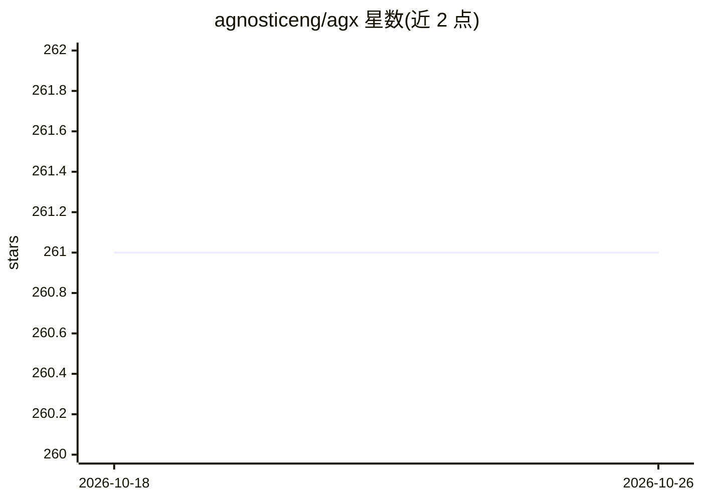

# agnosticeng/agx

⭐ 261 · Svelte · MIT · 推送 2026-03-10 · [GitHub](https://github.com/agnosticeng/agx) · [官网](https://agx.app) · 组织维护

**桌面/网页数据查询分析工具，支持本地 Ollama 模型**

基于 Tauri、SvelteKit 与 Plot 构建的数据探索与 SQL 查询应用：提供交互式 SQL 编辑器（语法高亮）、Schema 浏览器、表格化结果展示与拖放文件操作。可作原生桌面应用连接 ClickHouse，或作网页界面连接远程服务器实例；LLM 集成为其中一项功能，支持通过 Ollama 调用本地模型，网页版需设置 OLLAMA_ORIGINS 跨域。另有 Docker Compose 本地部署方式与可选的 ClickHouse UDF 安装脚本。

## 筛选速览

| 维度 | 判定 | 备注 |
|---|---|---|
| AI 角色 | `ai-enhanced` | 去掉 AI 部分产品仍成立 |
| 许可风险 | `permissive` | MIT |
| 部署形态 | `self-host` | docker 或自建部署 |
| 模型依赖 | local-ok | 支持本地模型 |
| 硬件要求 | — | 无带数字的原话,不猜 |
| 安装摩擦 | `low` | 无编译、无系统依赖或容器化 |
| 成熟度 | — | 结构信号不足 |

## 能力要点

- 交互式 SQL 查询编辑器与 Schema 浏览器
- 原生桌面应用（ClickHouse）或网页界面连接远程服务器两种形态
- Ollama 本地模型集成（网页版需配置 OLLAMA_ORIGINS）
- 跨平台支持（macOS/Linux/Windows），Docker Compose 本地部署

## 适用场景

- 在桌面端浏览数据结构并执行 SQL 查询
- 用本地 Ollama 模型辅助数据分析
- 通过 Docker 在本地部署网页版查询界面

## 场景标签

`数据分析` · 领域:效率与自动化

## 证据(README 行号)

> L3: **_agx_** is a desktop application that lets you explore and query data through a modern interface. It's built with 
> L13:  LLM Integration
> L29: #### Ollama Integration

## 星数曲线

2026-10-18 261 → 2026-10-26 261（+0）

---
*卡片 v1 · prompt 1.4 · 生成 2026-10-22 · 置信度 high · 依据 README sha `6f5241604bb1` · [字段定义](../../DATASET.md)*
