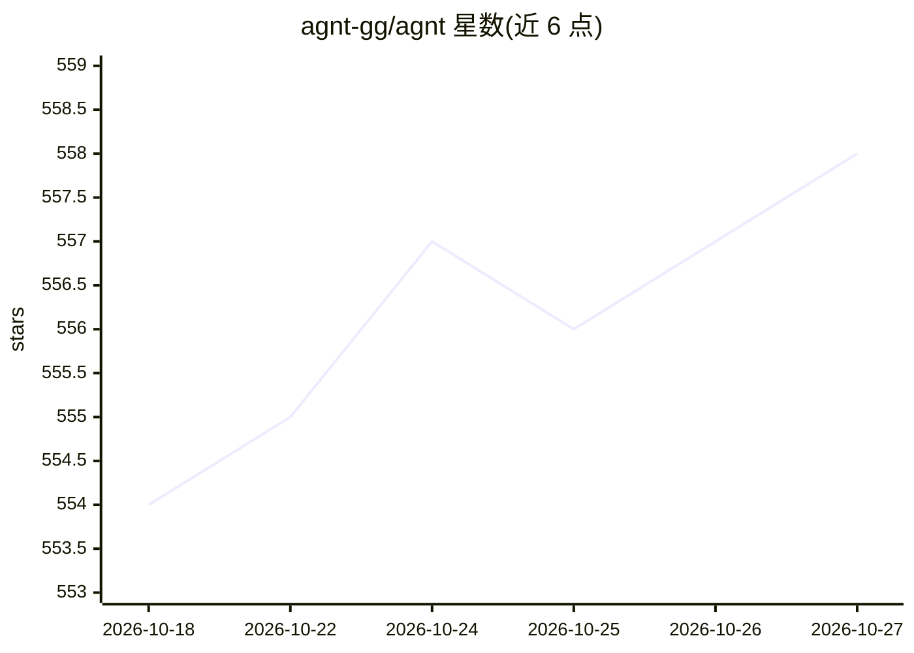

# agnt-gg/agnt

⭐ 558 · JavaScript · NOASSERTION · 推送 2026-10-26 · [GitHub](https://github.com/agnt-gg/agnt) · [官网](https://agnt.gg/) · 组织维护

**本地优先的 AI agent 操作系统：构建、运行和改进 agent 与工作流**

面向需要自托管 AI 自动化的开发者的桌面应用（Electron + Vue + Express + SQLite）及可 Docker 自部署后端，把 agent、可视化工作流（60+ 节点）、长期目标、子代理委派、记忆、插件（.agnt 包）、评测与轨迹整合到一个本地工作区。支持 15+ AI 提供商（OpenAI/Anthropic/Gemini/DeepSeek 等）与 MCP，本地 API 运行于 3333 端口；可无头运行于 VPS、树莓派等小服务器。限制：README 自述不适合纯托管聊天机器人或多租户公网托管场景。

## 筛选速览

| 维度 | 判定 | 备注 |
|---|---|---|
| AI 角色 | `ai-ecosystem` | LLM/agent 周边工具 |
| 许可风险 | `none` | NOASSERTION |
| 部署形态 | `self-host` | docker 或自建部署 |
| 模型依赖 | locked-api |  |
| 硬件要求 | — | 无带数字的原话,不猜 |
| 安装摩擦 | `low` | 无编译、无系统依赖或容器化 |
| 成熟度 | — | 结构信号不足 |

## 能力要点

- 三种执行模式：Agents / 可视化 DAG 工作流 / 长期目标（计划-执行-评估-重规划）
- 子代理委派：并行工作流分支、异步工具、MCP、插件、人工审批等
- 15+ AI 提供商接入与自定义端点，支持 MCP
- 本地 API（端口 3333）、SQLite 本地存储、插件市场分发

## 适用场景

- 搭建事件触发、可重复的本地 AI 自动化流程
- 用多个 agent 与工作流并行推进长期目标
- 在 VPS/树莓派/家庭服务器上自托管 agent 运行时

## 场景标签

`多智能体` `工作流自动化` `Agent 框架` · 领域:Agent 开发

## 证据(README 行号)

> L36: AGNT is a **local-first agent operating system**: a desktop app and self-hostable backend for building, running, ev
> L84: - 🧠 **Provider freedom** — OpenAI, Anthropic, Gemini, Grok, Groq, Cerebras, DeepSeek, OpenRouter, Together, Kimi, M

## 星数曲线

2026-10-18 554 → 2026-10-27 558（+4）

---
*卡片 v1 · prompt 1.4 · 生成 2026-10-21 · 置信度 high · 依据 README sha `85476c87d755` · [字段定义](../../DATASET.md)*
