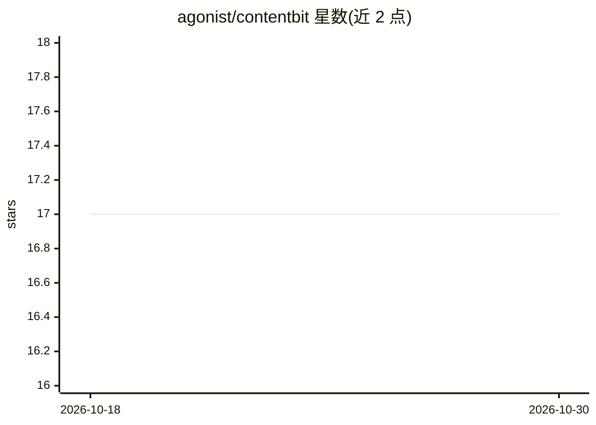

# agonist/contentbit

⭐ 17 · TypeScript · MIT · 推送 2026-09-29 · [GitHub](https://github.com/agonist/contentbit) · [官网](https://contentbit.dev) · 组织维护

**面向编码 agent 的程序化 SEO 内容契约与校验工具包**

开源程序化 SEO 工具包：以代码库中的页面契约定义可复用页面族（frontmatter、区块、内链），在 Markdown 文件存在前生成 agent 可用的写作简报；通过 Doctor 命令按契约校验内容结构与内部链接，输出分级问题与严格 CI 退出码。内容保持便携 Markdown，经 React、Astro 或纯 Markdown 适配器渲染。提供 CLI（init/validate/doctor/studio/brief）与多个 npm 包，可为 Codex、Cursor、Copilot、Claude Code 等 agent 安装指令文件。

## 筛选速览

| 维度 | 判定 | 备注 |
|---|---|---|
| AI 角色 | `ai-ecosystem` | LLM/agent 周边工具 |
| 许可风险 | `permissive` | MIT |
| 部署形态 | `library` | 以包/库形式分发 |
| 模型依赖 | — | README 未给出锁定关系 |
| 硬件要求 | — | 无带数字的原话,不猜 |
| 安装摩擦 | `low` | 无编译、无系统依赖或容器化 |
| 成熟度 | — | 结构信号不足 |

## 能力要点

- 页面契约生成 agent 写作简报（contentbit brief）
- Doctor 校验内容结构、链接与 SEO 契约，输出严格 CI 退出码
- 结构化 Markdown 的类型化指令区块，每区块带 schema 校验
- React/Astro/纯 Markdown 三种渲染适配器，shadcn 注册表分发

## 适用场景

- 批量生成程序化 SEO 页面并保持结构一致
- 给编码 agent 下发可执行的内容写作规则与验收标准
- 发布前校验内容结构、内链与薄段落等质量问题

## 场景标签

 · 领域:Web 开发/内容工程

## 证据(README 行号)

> L22: **Open-source programmatic SEO toolkit for coding agents.**
> L30: - **Give agents live rules** from the same contracts and block registry the CLI checks.
> L117: After `init --seo`, your agent has a short, repeatable writing loop:

## 星数曲线

2026-10-18 17 → 2026-10-30 17（+0）

---
*卡片 v1 · prompt 1.4 · 生成 2026-10-29 · 置信度 high · 依据 README sha `cd57bf0cd642` · [字段定义](../../DATASET.md)*
