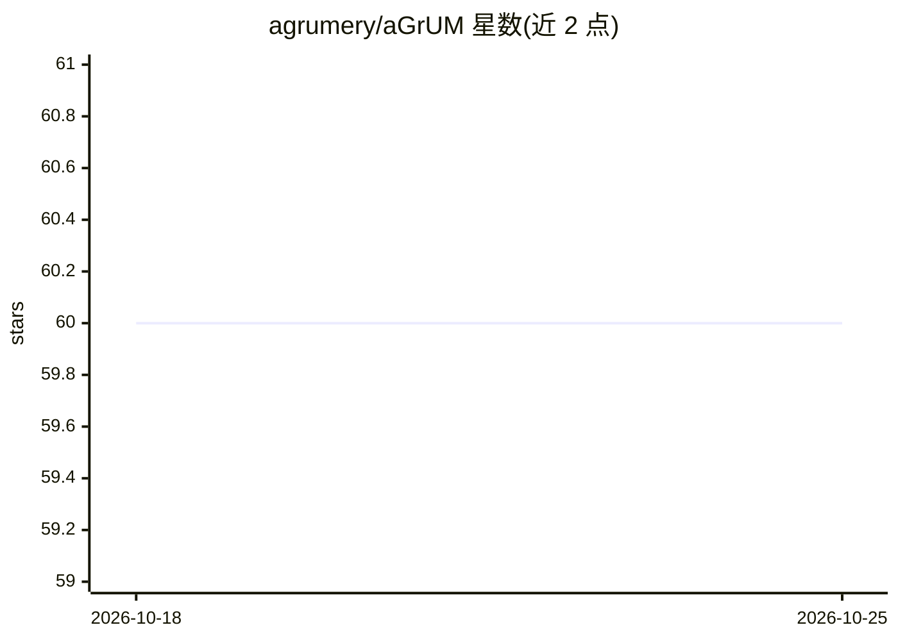

# agrumery/aGrUM

⭐ 60 · Jupyter Notebook · NOASSERTION · 推送 2026-10-23 · [GitHub](https://github.com/agrumery/aGrUM) · [官网](https://agrum.org) · 组织维护

**C++/Python 图模型库：贝叶斯网络学习、推断与因果分析**

aGrUM 是 C++20 编写的图模型库，覆盖贝叶斯网络、影响图、决策树、马尔可夫网络等模型的建模、学习与概率推断、规划决策；pyAgrum 是其经 SWIG 生成的 Python 封装，扩展提供 scikit-learn 兼容的贝叶斯网络分类器、因果网络与 do-calculus 分析工具、动态贝叶斯网络及可解释性工具。面向研究与数据科学应用，由 LIP6 图模型与决策研究团队发起。可通过 pip/conda 安装预编译包，或用自带 ACT 工具从源码构建。

## 筛选速览

| 维度 | 判定 | 备注 |
|---|---|---|
| AI 角色 | `ai-native` | 本体是模型或模型工具 |
| 许可风险 | `none` | NOASSERTION |
| 部署形态 | `library` | 以包/库形式分发 |
| 模型依赖 | — | README 未给出锁定关系 |
| 硬件要求 | — | 无带数字的原话,不猜 |
| 安装摩擦 | `medium` | 含编译或系统依赖之一 |
| 成熟度 | — | 结构信号不足 |

## 能力要点

- 贝叶斯网络等图模型的学习、推断与决策支持
- pyAgrum 提供 scikit-learn 兼容的概率分类器
- 因果分析工具：因果网络与 do-calculus
- 多线程算法与 C++20 跨平台（GCC/Clang/MSVC）

## 适用场景

- 构建与学习贝叶斯网络并做概率推断
- 用 do-calculus 做因果效应分析
- 训练与贝叶斯网络兼容的 scikit-learn 分类器
- 在 C++ 应用中嵌入图模型决策组件

## 场景标签

 · 领域:机器学习/概率图模型

## 证据(README 行号)

> L5: **aGrUM** is a fast and powerful C++ library for developing applications based on graphical models such as Bayesian
> L10: - Probabilistic inference with graphical models
> L18: - **Causal analysis tools**, including causal networks and do-calculus

## 星数曲线

2026-10-18 60 → 2026-10-25 60（+0）

---
*卡片 v1 · prompt 1.4 · 生成 2026-10-24 · 置信度 high · 依据 README sha `6fb2e3621fd5` · [字段定义](../../DATASET.md)*
