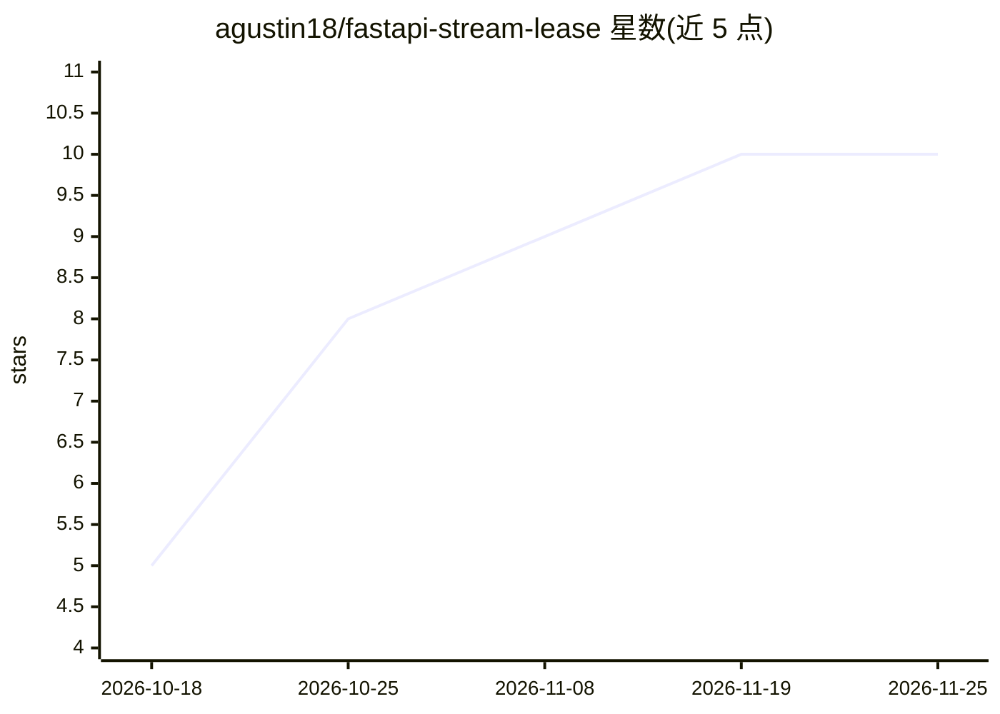

# agustin18/fastapi-stream-lease

⭐ 10 · Python · MIT · 推送 2026-11-14 · [GitHub](https://github.com/agustin18/fastapi-stream-lease) · [官网](https://pypi.org/project/fastapi-stream-lease/) · 个人维护

**为 FastAPI/Starlette 限流并发 SSE/LLM 流的 Redis 租约管理库**

基于 Redis 原子 Lua 脚本的分布式并发租约管理器，用于限制 FastAPI/Starlette 多 worker 下同时活跃的 SSE、LLM token 流与 WebSocket 会话数量，支持按用户与全局两级上限，超限连接在开始流式传输前收到 HTTP 429 与动态 Retry-After。租约需周期续期，过期由 Redis 时间自愈清理；提供 Redis 故障时的 fail_open/fail_closed 策略、获取超时宽限窗口、滚动部署时的 drain 关闭，以及分布式故障模型文档。要求 Python 3.10+ 与 Redis 服务器 5.0+。

## 筛选速览

| 维度 | 判定 | 备注 |
|---|---|---|
| AI 角色 | `ai-enhanced` | 去掉 AI 部分产品仍成立 |
| 许可风险 | `permissive` | MIT |
| 部署形态 | `self-host` | docker 或自建部署 |
| 模型依赖 | — | README 未给出锁定关系 |
| 硬件要求 | — | 无带数字的原话,不猜 |
| 安装摩擦 | `low` | 无编译、无系统依赖或容器化 |
| 成熟度 | — | 结构信号不足 |

## 能力要点

- 原子 Redis Lua 脚本执行按用户+全局两级并发检查，兼容 Redis Cluster hash tag
- 租约自动续期与基于 Redis TIME 的过期自愈，避免 worker 时钟漂移影响
- Redis 中断时可配置 fail_open（内存回退）或 fail_closed（HTTP 503）
- SIGTERM 时 manager.close(drain=True) 等待活跃流自然结束，防止幽灵租约

## 适用场景

- 限制每个用户同时打开的 LLM 聊天流数量
- 控制多 worker 部署下的 SSE/WebSocket 并发会话上限
- 滚动发布时优雅排空活跃流连接

## 场景标签

 · 领域:Web 开发/后端基础设施

## 证据(README 行号)

> L8: Limit **simultaneously active** SSE, LLM token streams, and WebSocket sessions across FastAPI/Starlette workers with
> L12: Request rate limiters answer “how many requests arrived this minute?” This package answers “how many streams are op
> L34: Requires Python 3.10+, a Redis server 5.0+, and the Python client `redis-py` 4.6.0+.

## 星数曲线

2026-10-18 5 → 2026-11-25 10（+5）

---
*卡片 v1 · prompt 1.4 · 生成 2026-11-20 · 置信度 high · 依据 README sha `588193d92efd` · [字段定义](../../DATASET.md)*
