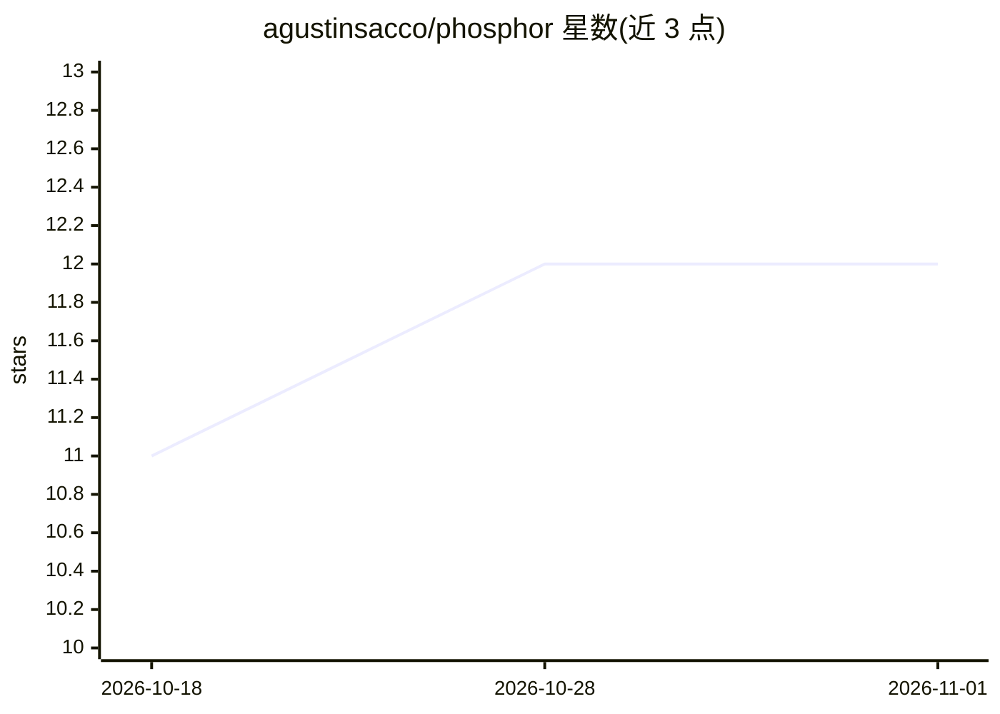

# agustinsacco/phosphor

⭐ 12 · TypeScript · MIT · 推送 2026-10-29 · [GitHub](https://github.com/agustinsacco/phosphor) · [官网](https://phosphor.saccolabs.com) · 个人维护

**基于 pi 编码代理的开源多代理桌面 IDE**

Phosphor 是构建在 pi coding agent 之上的 Electron 桌面 IDE（macOS/Linux，Windows 构建暂停）。每个会话是一个真实的 pi --mode rpc 子进程：聊天旁挂文件浏览器、终端、变更面板与工件面板；支持并行 lane（每任务独立 agent 与 Git worktree）和 lane 内子代理委派。可用 ChatGPT/Claude 订阅或任意 pi 支持的 API key 提供方，中途切换模型。安装依赖 Node ≥ 22.19 的 pi。

## 筛选速览

| 维度 | 判定 | 备注 |
|---|---|---|
| AI 角色 | `ai-ecosystem` | LLM/agent 周边工具 |
| 许可风险 | `permissive` | MIT |
| 部署形态 | `desktop` | 安装包/桌面程序 |
| 模型依赖 | locked-api |  |
| 硬件要求 | — | 无带数字的原话,不猜 |
| 安装摩擦 | `low` | 无编译、无系统依赖或容器化 |
| 成熟度 | — | 结构信号不足 |

## 能力要点

- 每个会话是真实的 pi RPC 子进程，UI 暴露 pi 的模型、fork、压缩等全部能力
- 每任务独立 agent 与 Git worktree 的并行 lane，含可选子代理委派
- 所有变更可逐文件审查与回退，工件带版本与预览
- 支持 ChatGPT Plus/Pro、Claude Pro/Max 订阅及 Anthropic/OpenAI/Gemini/Bedrock 等多家 API

## 适用场景

- 在一个窗口里并行运行多个编码 agent 任务并审查其改动
- 用已付费的 ChatGPT/Claude 订阅驱动本地编码代理
- 在 IDE 内管理 MCP 连接器、终端与工件

## 场景标签

`编码 Agent` `多智能体` · 领域:Agent 开发

## 证据(README 行号)

> L5: **One mission. Many agents. Your IDE.** Phosphor is the open-source multi-agent
> L59: - **Sessions are real pi subprocesses.** One `pi --mode rpc` per live session,
> L282: One `pi --mode rpc` subprocess per live session, spoken to over JSONL on stdio.

## 星数曲线

2026-10-18 11 → 2026-11-01 12（+1）

---
*卡片 v1 · prompt 1.4 · 生成 2026-11-01 · 置信度 high · 依据 README sha `56d69141000e` · [字段定义](../../DATASET.md)*
