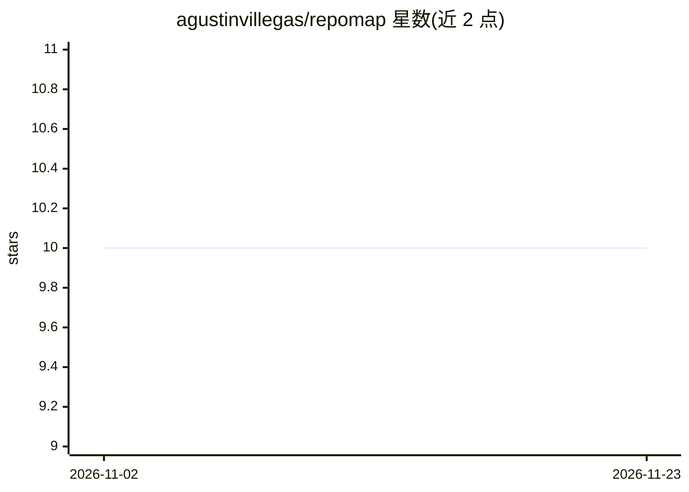

# agustinvillegas/repomap

⭐ 10 · JavaScript · MIT · 推送 2026-07-17 · [GitHub](https://github.com/agustinvillegas/repomap) · 个人维护

**为编码 agent 生成仓库架构图谱的 skill 工具**

一个面向 CLI 编码 agent 的 skill：先用确定性扫描器（analyzer.js）提取仓库目录层级、imports、函数签名、模块关系与 git 信息，全程不调用 LLM、不发送源码；随后仅将结构化结果交给 LLM 做一次架构推理（角色判定、模式识别、布局生成），渲染为 React Flow 可交互图谱并支持 Git 历史（commit/branch/增删文件高亮）浏览。通过 .opencode/skills 目录被 OpenCode 和 Claude 自动发现，提供 CLI（list/open）与 RepoGraph JSON 格式。安装依赖 Node/npm，从源码克隆。

## 筛选速览

| 维度 | 判定 | 备注 |
|---|---|---|
| AI 角色 | `ai-ecosystem` | LLM/agent 周边工具 |
| 许可风险 | `permissive` | MIT |
| 部署形态 | `library` | 以包/库形式分发 |
| 模型依赖 | — | README 未给出锁定关系 |
| 硬件要求 | — | 无带数字的原话,不猜 |
| 安装摩擦 | `low` | 无编译、无系统依赖或容器化 |
| 成熟度 | — | 结构信号不足 |

## 能力要点

- 确定性仓库扫描不调用 LLM，零源码发送给 LLM
- 仅一次 LLM 推理生成架构角色与模式标注
- React Flow 交互图谱，支持分支编辑与持久化存储
- Git 历史可视化：inspect commits、browse branches、增删改文件高亮

## 适用场景

- 让编码 agent 快速回答认证在哪实现、模块依赖关系等问题而不反复读文件
- 降低 agent 会话中仓库理解阶段的 token 消耗
- 人工浏览大型仓库的交互式架构图
- 结合 Git 历史查看分支或 commit 的结构变化

## 场景标签

`编码 Agent` · 领域:编码与开发

## 证据(README 行号)

> L3: Give coding agents architectural awareness.
> L127: RepoMap was built to integrate naturally with tools such as OpenCode and Claude.

## 星数曲线

2026-11-02 10 → 2026-11-23 10（+0）

---
*卡片 v1 · prompt 1.4 · 生成 2026-11-20 · 置信度 high · 依据 README sha `4c4b32bc30cb` · [字段定义](../../DATASET.md)*
