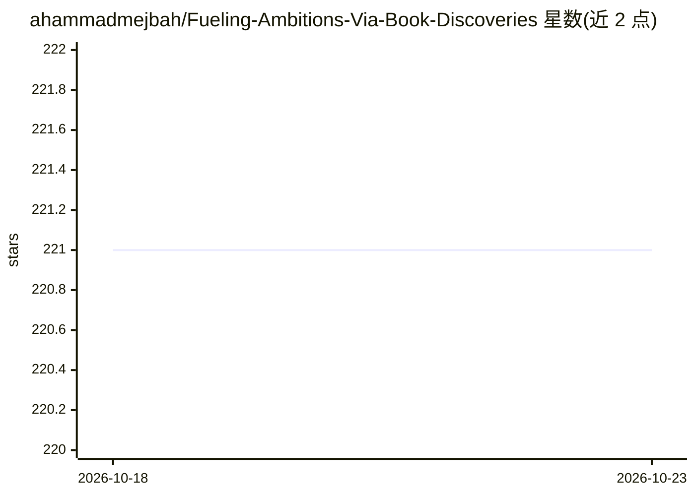

# ahammadmejbah/Fueling-Ambitions-Via-Book-Discoveries

⭐ 221 · 推送 2026-06-07 · [GitHub](https://github.com/ahammadmejbah/Fueling-Ambitions-Via-Book-Discoveries) · 个人维护

**AI/机器学习/数据科学书籍洞见内容系列（README 为空，无法核实）**

仅能依据仓库描述：该仓库是一个从 AI、机器学习与数据科学书籍中提取洞见的内容系列，目标是将复杂理论转化为实践知识，面向自学者。README 内容为空，无法核实条目数量、组织形式、更新机制或任何安装运行方式，也不存在可引用的行号证据。

## 筛选速览

| 维度 | 判定 | 备注 |
|---|---|---|
| AI 角色 | `ai-knowledge` | 知识聚合/清单类 |
| 许可风险 | `none` | — |
| 部署形态 | `None` |  |
| 模型依赖 | — | README 未给出锁定关系 |
| 硬件要求 | — | 无带数字的原话,不猜 |
| 安装摩擦 | `low` | 无编译、无系统依赖或容器化 |
| 成熟度 | — | 结构信号不足 |

## 能力要点

- 仓库描述声明覆盖 AI/ML/数据科学书籍的洞见提炼
- 以系列（series/episode）形式组织内容

## 适用场景

- 查找 AI 与数据科学书籍的核心观点摘要

## 场景标签

 · 领域:AI/数据科学知识内容

## 星数曲线

2026-10-18 221 → 2026-10-23 221（+0）

---
*卡片 v1 · prompt 1.4 · 生成 2026-10-22 · 置信度 low · 依据 README sha `da39a3ee5e6b` · [字段定义](../../DATASET.md)*
