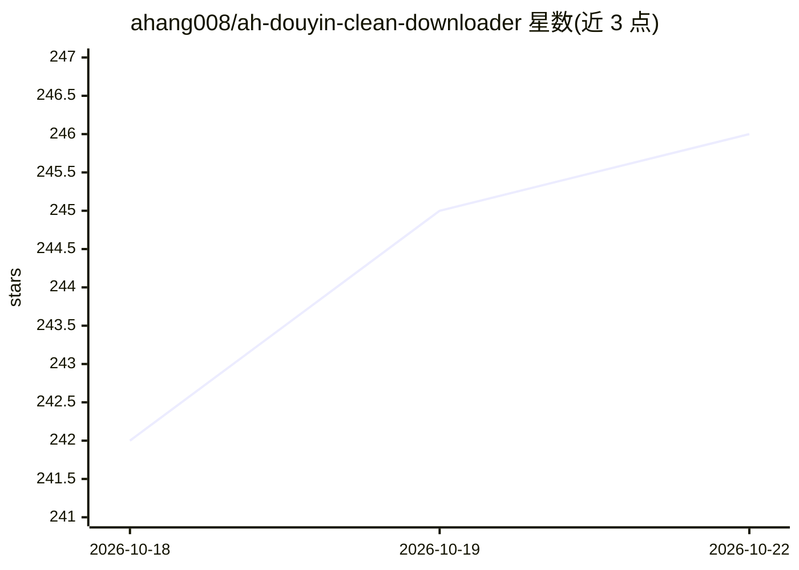

# ahang008/ah-douyin-clean-downloader

⭐ 249 · Python · NOASSERTION · 推送 2026-10-03 · [GitHub](https://github.com/ahang008/ah-douyin-clean-downloader) · 个人维护 · 中文 README

**Codex 技能：下载抖音原视频、转写归档与批量改写口播稿**

面向 Codex 的单仓库 Skill（v0.6.0）：输入单条链接下载平台播放源原视频（不转码）；加指令后本地识别生成逐字稿与 SRT 并做语义校对；输入博主主页可采集公开作品、指标、文案标签封面文字并生成索引，支持续跑；对已有资料库按点赞排序批量改写为口播稿。限制：不能去除上传前已烧录的 Logo/字幕，批量机器稿未经人工校对，语义校对与改写消耗额外模型用量。仅限自有或已授权公开内容。

## 筛选速览

| 维度 | 判定 | 备注 |
|---|---|---|
| AI 角色 | `ai-native` | 本体是模型或模型工具 |
| 许可风险 | `none` | NOASSERTION |
| 部署形态 | `None` |  |
| 模型依赖 | — | README 未给出锁定关系 |
| 硬件要求 | — | 无带数字的原话,不猜 |
| 安装摩擦 | `low` | 无编译、无系统依赖或容器化 |
| 成熟度 | — | 结构信号不足 |

## 能力要点

- 下载平台播放源原视频，保留原始音视频不转码
- 本地识别+语义校对输出 Markdown 逐字稿与 SRT
- 博主公开作品批量采集、指标表与可续跑索引
- 按点赞排序批量改写资料库为口播稿

## 适用场景

- 下载并归档自己或已授权博主的抖音原视频与逐字稿
- 整理创作者资料库并批量生成口播稿
- 为已有完整资料库建立按点赞排序的索引与核对清单

## 场景标签

`网页抓取` `语音识别` `AI 写作` · 领域:效率与自动化

## 证据(README 行号)

> L3: 同一个 Codex Skill 下载单条抖音原视频、交付校对后的单条逐字稿与 SRT、归档博主公开作品并生成本地机器稿，也能把已有完整资料库按点赞排序批量改写成口播稿。
> L12: |单条链接，并说明“提取逐字稿”|本地识别，再完成整篇语义校对；最终只保留校对后的 Markdown 和原时间码 SRT，清理受控过程文件。|

## 星数曲线

2026-10-18 242 → 2026-10-22 246（+4）

---
*卡片 v1 · prompt 1.4 · 生成 2026-10-22 · 置信度 high · 依据 README sha `b345f312037d` · [字段定义](../../DATASET.md)*
