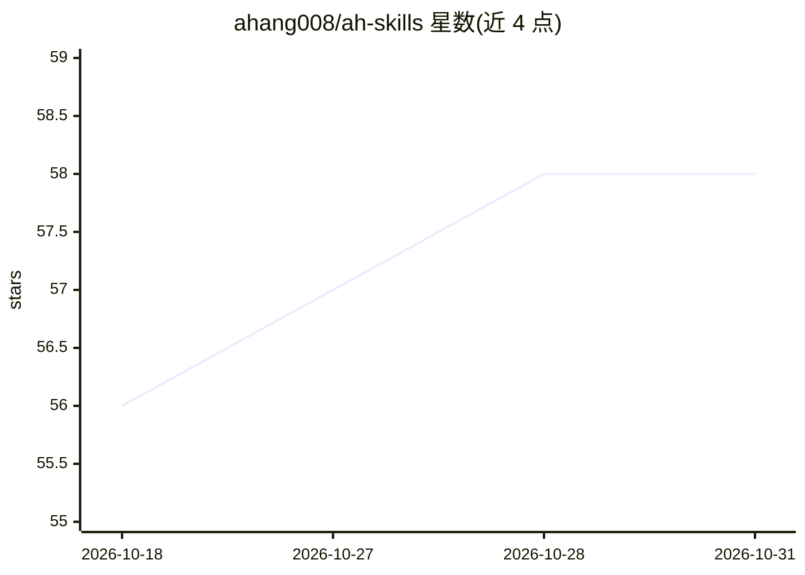

# ahang008/ah-skills

⭐ 58 · Python · NOASSERTION · 推送 2026-10-08 · [GitHub](https://github.com/ahang008/ah-skills) · 个人维护 · 中文 README

**个人公开的 Codex Agent Skills 集合与品牌索引**

阿杭维护的 Codex Skills 目录仓库：收录以 `ah-` 为前缀、来自真实工作流的工具 Skill，包括抖音无角标下载、长口播切片矩阵、思考澄清工具，以及两个视频系列入口和一个 Gemini 中文润色写作桥。工具 Skill 含可运行脚本、使用边界、测试与来源说明；系列入口只做参数编排，具体能力由另行安装的剪辑引擎等外部依赖提供。单个 Skill 通过把 GitHub 链接发给 Codex 安装，本仓库承担品牌目录与索引职能。

## 筛选速览

| 维度 | 判定 | 备注 |
|---|---|---|
| AI 角色 | `ai-knowledge` | 知识聚合/清单类 |
| 许可风险 | `none` | NOASSERTION |
| 部署形态 | `None` |  |
| 模型依赖 | — | README 未给出锁定关系 |
| 硬件要求 | — | 无带数字的原话,不猜 |
| 安装摩擦 | `low` | 无编译、无系统依赖或容器化 |
| 成熟度 | `idea` | |

## 能力要点

- 收录 6 个 `ah-` 前缀 Skill，含状态标注（试用/已发布/系列入口）
- 工具 Skill 附可运行脚本、使用边界、测试与来源说明
- 安装方式为把 Skill 的 GitHub 链接直接发给 Codex
- 系列入口仅编排外部依赖，不含第三方剪辑引擎

## 适用场景

- 为 Codex 安装抖音链接下载、口播切片等具体工作流 Skill
- 查看该作者 Skill 的发布范围、外部依赖与许可来源
- 按系列入口参数复用已确认的视频制作流程

## 场景标签

`工作流自动化` `AI 写作` · 领域:效率与自动化

## 证据(README 行号)

> L3: 阿杭公开的 Codex Skills 集合。
> L5: 这里不堆提示词，也不把概念 Demo 当成成品。工具 Skill 来自真实工作流，包含可运行脚本、使用边界、测试和来源说明；系列入口提供制作范围与外部依赖的编排，具体运行能力由依赖提供。
> L22: 后续新增工具 Skill 统一使用 `ah-` 前缀，并建立独立 GitHub 仓库。本仓库负责品牌目录和索引，同时收录阿杭独立编写的两个系列入口，以及本次明确发布在此仓库的 Gemini 写作桥试用包；系列入口只编排外部 Ski

## 星数曲线

2026-10-18 56 → 2026-10-31 58（+2）

---
*卡片 v1 · prompt 1.4 · 生成 2026-10-24 · 置信度 high · 依据 README sha `4871c4b2ed51` · [字段定义](../../DATASET.md)*
