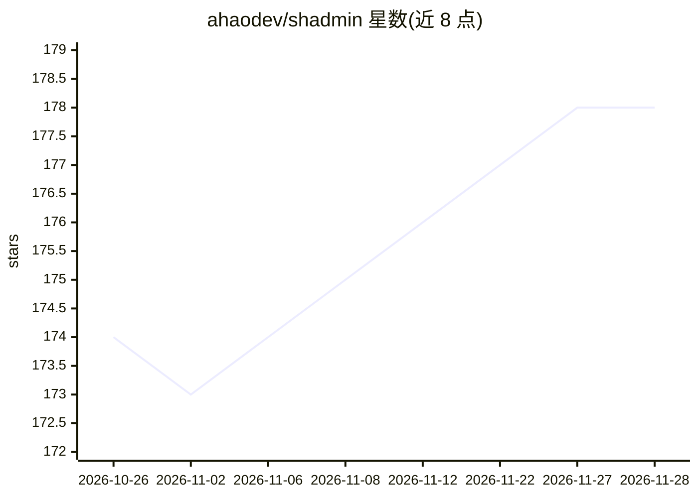

# ahaodev/shadmin

⭐ 178 · TypeScript · MIT · 推送 2026-11-27 · [GitHub](https://github.com/ahaodev/shadmin) · [官网](https://shadmin.ahaodev.com) · 个人维护 · 中文 README

**给开发者提供 Go+React 全栈 RBAC 权限管理后台**

基于 Gin、Ent ORM、Casbin 与 React（Shadcn UI、TanStack Router、Tailwind CSS）构建的全栈 RBAC 权限管理系统，提供 API 与菜单的细粒度角色权限控制、后端驱动的动态菜单、全局搜索、数据看板、明暗主题等。支持 SQLite（默认）、PostgreSQL、MySQL 多数据库，缓存可选 Redis 或 go-cache。源码方式克隆运行，首启自动初始化 SQLite 并写入种子数据，提供 Swagger 文档与面向 AI agent 的 CLI 文档。

## 筛选速览

| 维度 | 判定 | 备注 |
|---|---|---|
| AI 角色 | `ai-enhanced` | 去掉 AI 部分产品仍成立 |
| 许可风险 | `permissive` | MIT |
| 部署形态 | `library` | 以包/库形式分发 |
| 模型依赖 | — | README 未给出锁定关系 |
| 硬件要求 | — | 无带数字的原话,不猜 |
| 安装摩擦 | `low` | 无编译、无系统依赖或容器化 |
| 成熟度 | — | 结构信号不足 |

## 能力要点

- 基于 Casbin 的 API 与菜单细粒度 RBAC 权限控制
- 后端驱动的动态菜单树与权限感知渲染
- 开箱支持 SQLite/PostgreSQL/MySQL 多数据库
- 提供面向 AI agent 的 CLI

## 适用场景

- 快速搭建带角色权限管理的管理后台
- 为内部系统接入 API 与菜单级权限控制
- 作为 Go + React 全栈项目开发参考

## 场景标签

 · 领域:企业应用/权限管理

## 证据(README 行号)

> L58: - CLI for AI agents
> L3: **An Enterprise-Grade Full-Stack RBAC Permission Management System Built with Go + React**

## 星数曲线

2026-10-26 174 → 2026-11-28 178（+4）

---
*卡片 v1 · prompt 1.4 · 生成 2026-11-28 · 置信度 mid · 依据 README sha `73c5322851e7` · [字段定义](../../DATASET.md)*
