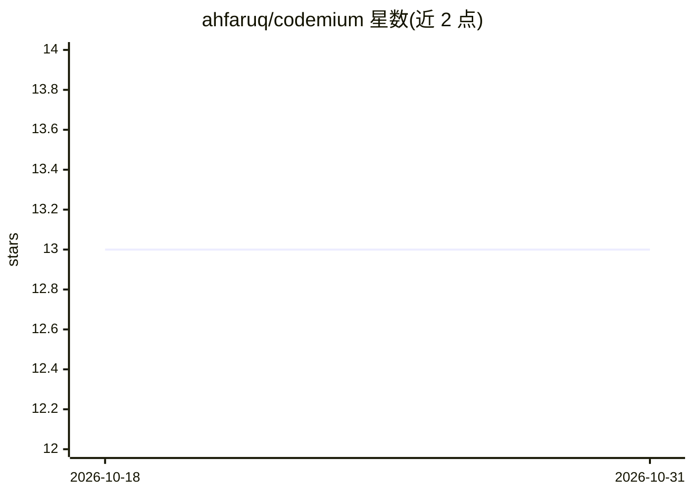

# ahfaruq/codemium

⭐ 13 · Python · MIT · 推送 2026-09-05 · [GitHub](https://github.com/ahfaruq/codemium) · 个人维护

**给 AI 编码代理的持久化工程层：项目知识与变更纪律**

宿主无关的编码代理工程层（v0.10.0，MIT）：通过 Project Brain 在任务间保存经核验的项目知识（决策、约束、接口、已知缺陷），用 Structural Graph v3 提供跨语言仓库结构图（Python AST，JS/TS 可选 Tree-sitter），并以 Execution Intelligence（矛盾门、假设台账、证据增量门）约束调查过程，以 Slop Guard（变更归属分类、来源追踪、欠工程反向门）约束最终变更面。支持 OpenAI Codex（稳定）及 Claude Code、Gemini CLI、Cursor、OpenCode（Beta），通过插件/skill 方式接入，另提供确定性 CLI 辅助脚本。README 声明不基于确定性夹具发布性能数字。

## 筛选速览

| 维度 | 判定 | 备注 |
|---|---|---|
| AI 角色 | `ai-ecosystem` | LLM/agent 周边工具 |
| 许可风险 | `permissive` | MIT |
| 部署形态 | `None` |  |
| 模型依赖 | — | README 未给出锁定关系 |
| 硬件要求 | — | 无带数字的原话,不猜 |
| 安装摩擦 | `low` | 无编译、无系统依赖或容器化 |
| 成熟度 | — | 结构信号不足 |

## 能力要点

- Project Brain 持久化经核验的项目知识并做新鲜度分级（FRESH/SUPERSEDED 等）
- Execution Intelligence：矛盾门、假设台账、证据增量门，阻止零信息调查循环
- Slop Guard：变更面归属分类（DIRECT/DEPENDENCY/CLEANUP/TEST）与来源追踪
- 支持 5 种宿主（Codex 稳定，Claude Code/Gemini CLI/Cursor/OpenCode Beta）

## 适用场景

- 长周期项目中让编码代理复用已验证的仓库知识
- 约束 AI 代理只做最小且可归因的工程变更
- 审查一次变更中是否包含与任务无关的改动

## 场景标签

`代码审查` `Agent 记忆` · 领域:Agent 开发

## 证据(README 行号)

> L15: Codemium is a host-agnostic engineering layer for long-running software projects.
> L17: It helps coding agents:

## 星数曲线

2026-10-18 13 → 2026-10-31 13（+0）

---
*卡片 v1 · prompt 1.4 · 生成 2026-10-31 · 置信度 high · 依据 README sha `496357996ec1` · [字段定义](../../DATASET.md)*
