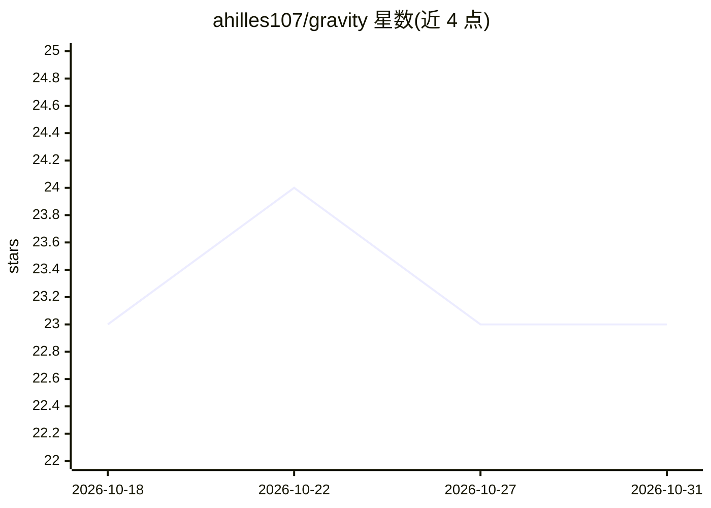

# ahilles107/gravity

⭐ 23 · Rust · MIT · 推送 2026-10-02 · [GitHub](https://github.com/ahilles107/gravity) · [官网](https://getgravity.build) · 个人维护

**常驻多机器人 AI 编码代理的桌面工作区**

基于 Tauri 的桌面客户端加 Rust 守护进程 gravityd 组成的多 bot 工作区：以 Claude Code 或 Codex CLI 作为代理运行时，运行时适配器在 PTY 中启动 claude 并由 xterm.js 渲染终端。守护进程提供持久消息投递（带重试与回退）、bot 间任务与防环、cron/间隔/信号触发的例程调度、gravity-bus MCP 服务器与经认证可重连的 WebSocket 控制平面。支持 macOS 与 Windows x64，提供 DMG/安装包发布；远程客户端通过设备级令牌经 Tailscale 接入。

## 筛选速览

| 维度 | 判定 | 备注 |
|---|---|---|
| AI 角色 | `ai-ecosystem` | LLM/agent 周边工具 |
| 许可风险 | `permissive` | MIT |
| 部署形态 | `desktop` | 安装包/桌面程序 |
| 模型依赖 | locked-api |  |
| 硬件要求 | — | 无带数字的原话,不猜 |
| 安装摩擦 | `medium` | 含编译或系统依赖之一 |
| 成熟度 | — | 结构信号不足 |

## 能力要点

- 以 Claude Code / Codex CLI 为运行时，守护进程在 PTY 中启动并渲染原生终端
- 持久消息投递：租约、退避重试、hop 计数与来源链防环
- gravity-bus MCP 服务器提供 send_message / complete_task / check_inbox 等工具
- WS 控制平面（协议 v2）支持认证、版本化、重连与终端回放

## 适用场景

- 让多个 AI 编码 bot 在同一工作区常驻运行并互相协作
- 通过桌面或远程客户端观察与控制 bot 终端会话
- 用 cron/间隔/信号触发 bot 例程任务

## 场景标签

`多智能体` `编码 Agent` · 领域:Agent 开发

## 证据(README 行号)

> L3: Always-on, multi-bot desktop app with Claude Code or Codex CLI as the agent runtime.
> L194: ## How it works, briefly
> L199:  report state to the daemon). The runtime adapter spawns `claude` there in a

## 星数曲线

2026-10-18 23 → 2026-10-31 23（+0）

---
*卡片 v1 · prompt 1.4 · 生成 2026-10-27 · 置信度 high · 依据 README sha `bc9c64a876c4` · [字段定义](../../DATASET.md)*
